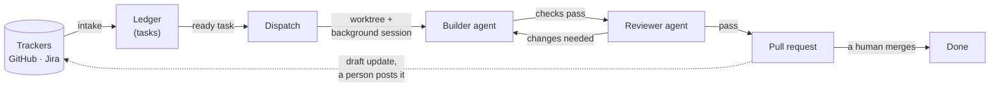
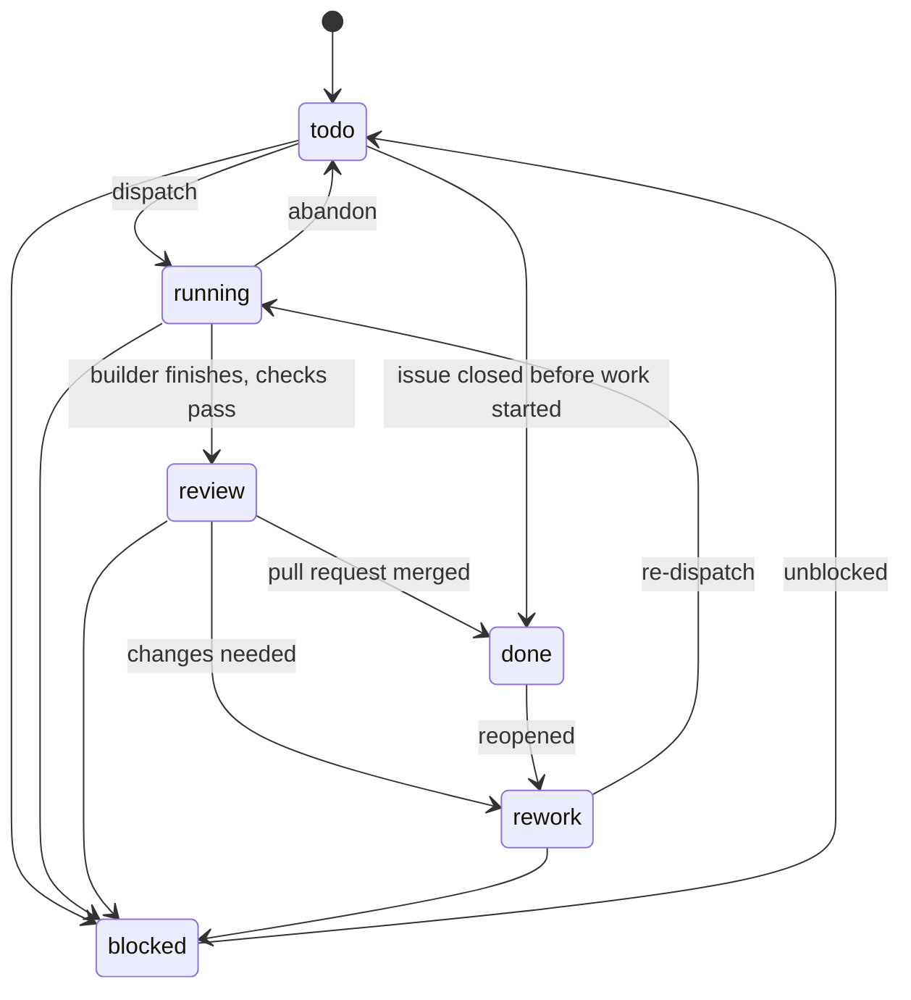

# Design

**Status:** agreed with the user on 2026-10-01. Later changes are recorded in [DECISIONS.md](DECISIONS.md). It introduces decisions D-008 to D-018
(see [DECISIONS.md](DECISIONS.md)). Behaviour that comes from Claude Code itself
was checked against version 2.1.287 and its docs on that date.

## 1. What it does

Agent Command Center turns tickets into reviewed pull requests, with a human
deciding what merges, or autopilot where a repo turns auto-merge on (§12). Tickets come in from GitHub Issues or Jira and become
tasks. Each ready task gets its own git worktree and a background Claude Code
session. The agent builds the change and runs the project's checks. A second,
fresh agent reviews the diff, a pull request opens, and acc drafts an update
for the ticket, which a person reads, edits and posts. A VSCode panel shows all
of it and holds the buttons.



## 2. The pieces

| Piece | What it is | Uses |
|---|---|---|
| `core` | TypeScript library: ledger, config, state rules, paths, receipts | filesystem only |
| `acc` CLI | Every action, and the **only writer** of state | core, `git`, `gh`, `claude`, `sf` |
| Plugin `acc` | Skills, hooks, a reviewer agent, and `bin/acc` for agents | Claude Code |
| VSCode extension | Views and buttons. Reads state directly, changes it only through `acc` | core, `acc`, `claude agents --json`, `gh` |

Claude Code supplies the agent runtime, and none of it is rebuilt here:

- background sessions (`claude --bg`), with `claude attach`, `logs` and `stop`
- live status (`claude agents --json`)
- hooks

### Where the code lives (D-099)

Each area of the Command Center has its own modules, so parallel builders
rarely touch the same file. Where something must name every area, each area
says so in its own module, as `export const area`, and a generated index
gathers them.

| Folder | What's in it | An area declares |
|---|---|---|
| `packages/cli/src/commands/` | One module per group of acc's commands: setup, tasks, agents (dispatch, done, block, resume, cleanup, agents, machine), pipeline (analyze, review, land, autopilot, sync), updates, environments, hooks, github, checks. `main.ts` is the entry, `shared.ts` what every group uses | its help lines (`section`, `order`, `lines`), the options it reads, its commands, and any argv a command needs changed first |
| `extension/src/model/` | The page's view models, a module per area: overview, history, tasks (the agent board), cards (what a task's card says), boards (tracker boards), task-page, updates, agents, questions, agent-page, runs, connect, worktrees, environments, setup, slack, settings (its parts, the theme's choices, and How agents run: each project's builders, reviewers, autonomy and auto-merge), and page (the page's own messages). `home.ts` builds the page from the areas' parts, `messages.ts` gathers their messages, `shared.ts` holds what several use | the messages its parts send with their checks (`messages`, and its `Message` type), the acc.* commands they may ask for (`commands`), and what it adds to the page (`home`: Needs you for each project or once, stat tiles, its item in the rail, in its `order`) |
| `extension/src/logic/` | Pure decisions, a module per area: setup and the walkthrough, tasks, agents, worktrees, environments, connect and trackers, runs, notices, autopilot, the status bar, polls (how often each thing is looked at again, which Settings says), efforts (Dispatch with…'s effort step); `shared.ts` holds a task's row and an agent's session | nothing: nothing names every area here |
| `extension/src/` | Each area's VS Code side: tasks, agents, worktrees and environments (their commands, subclasses of `sidebar.ts`'s shared base), setup, trackers and the Connect page, identity, slack, notices (the status bar's menu), autopilot, progress (In progress's Stop), ticket (a task's page, in its own tab or over the Tasks board), task-modal (wires that modal to the Command Center), questions, runs, settings (the theme every tab follows, and Settings' Refresh). `extension.ts` builds the extension's parts and hands them to every area; `hub.ts` loads, polls and caches (`task-rows.ts` reads a task's row); `panels.ts` handles the page's own messages | `register(parts)`: its commands, and with `receive` the page's messages it takes |
| `extension/webview/` | The page, flat so its tsconfig and the screenshot harness's staleness check see every file: overview, progress, tasks, task-page, task-modal (a task's page over the Tasks board), updates, analysis, questions, agents, agent-page, dock, connect, worktrees, environments, slack, setup, settings, and theme (the page's `data-theme`). `main.ts` is the entry; `state.ts` owns the page's state, `dom.ts` builds elements, `boards.ts` holds what boards share, `rail.ts` draws the rail, `looks.ts` holds the page's own tables of how a state shows, with no DOM, so the looks test can walk them (GH-105) | the sections and tabs it draws, what it draws over a section, its hooks around a draw, and the extension's messages it takes |
| `packages/core/src/` | dispatch.ts (the start and cleanup), packet.ts, held.ts and holding.ts (D-093), efforts.ts (each model's effort levels, and a task's builder effort, D-128); autopilot.ts (its mode and pass), autopilot-rules.ts, autopilot-log.ts; repos.ts (the repos acc set up on this machine, and which place each uses, GH-81). `index.ts` is generated: `export *` from each module by file name, then onboarding's (GH-95) | nothing: a module the index takes only some names from is in `scripts/areas.ts`'s `CORE_INDEX`, with why |

**A new command, message or section.** Add it to its area's module: a CLI
command to its group's `commands`, its help line to `lines` and any options to
`options`; a message the page sends to the model area's `Message` and
`messages`, and its handler to the extension area's `register` with
`receive`; an acc.* command the page asks for to the model area's `commands`.
**A new area** is a new module in the folder that declares `export const area`.
Run `npm run build`: `scripts/areas.ts` writes the folder's index (its
`AREAS`, and in model/ the `Message` union), headed "Generated … Don't edit
it", and `scripts/test/areas.test.ts` fails while one is stale.

**What still names every section** is the page's table of contents: the
sections and their titles in `model/shared.ts`, the section models a
`HomeModel` holds, each section's Refresh in `panels.ts`, and the union of the
page's models. A whole new section edits those as well as its own modules.

**The rules.** An area module imports shared modules and other areas, never an
index, so nothing loads an index from inside it. Tests import the area module
they test, not a barrel. A module node:test loads stays free of vscode: an
extension area that is also pure takes VS Code's API from the parts.

### Each area's fixtures, styles, tests and commands (GH-95)

The files every task used to touch follow the same areas, so a feature edits
only its own:

| What | Where | Adding one |
|---|---|---|
| The screenshots' sample data | `extension/scripts/fixtures/`, a module per area: tasks, agents (their sessions and ledgers), questions, history (and autopilot's steps), updates, analysis, boards, connect, task-page, agent-page, setup, runs, slack, environments, progress (In progress), overview (the merge queue), settings (a second project and per-token billing, for How agents run). `hub.ts` puts the sample project together; `shared.ts` holds its paths and its builders' names | add it to its area's module; the screenshot script imports the module it draws from |
| The page's styles | `extension/webview/styles.css` holds what every area shares; `<module>.css` beside a module of the page holds that area's own. `theme.css` holds the Light and Dark palettes: no other file writes a colour, but for the masks and a tracker label's own colour, which `colours.test.ts` lists with why (GH-109, GH-105). npm run build writes styles.css first, then the rest by file name, into one `dist/webview/styles.css`; `extension/scripts/styles.ts` gives the tests the same | a rule two areas need goes in styles.css, since the areas' order is only their names. A `.css` named for no module of the page fails the build |
| The extension's tests | `extension/test/<area>.test.ts`, named for what they test: setup, page, notices, tasks, cards, autopilot, agents, trackers, worktrees, environments, overview, updates, history, boards, and connect, progress, slack, tickets and the rest from before. `support.ts` holds what several share | put it in its area's file, so the near-tests gate (§9) finds it by name as well as by import |
| The CLI's tests | `packages/cli/test/<module>.test.ts`, a file per command group, named for its module in `packages/cli/src/commands/`: setup (and main.ts's own help), rules, trackers, tidy, tasks, updates, pipeline, checks, agents, github. Each names `../src/main.ts` itself and runs it through `cli()` in `support.ts`, which holds what they share (GH-131), as `refusals.test.ts` does. `cli()` builds acc's environment and takes spawn options, such as a timeout, so no test spawns acc with an environment of its own; only `junk.test.ts` (the built acc, in its own sandbox) and `launcher.test.ts` (the launcher script) run something else (GH-148) | put it in its command's file, so the near-tests gate (§9) finds it by name; `scripts/test/near-tests.test.ts` checks every command module is near each group's file, and `support.test.ts` that every file runs main.ts through `cli()` |
| The commands the extension contributes | `extension/commands/<module>.json`, named for the module in `extension/src/` that registers them. npm run build writes package.json's `contributes.commands` from them, by file name; `extension/test/areas.test.ts` checks each is in the right file | add it to its registering module's file, then run npm run build |
| Core's exports | `packages/core/src/index.ts`, written by `scripts/areas.ts` | nothing, for a new module |

**A new kind of per-area file** that tests read through a script, not by
import, adds a row to `READS` in `scripts/near-reads.ts`: the files, and the
script that reads them (GH-117). The near-tests gate (§9) then runs the tests
near that script whenever one of the files changes, as it does for the
stylesheets (`extension/scripts/styles.ts`), the commands files and
`extension/package.json` (`extension/scripts/generate.ts`).
scripts/test/near-tests.test.ts checks that every file of each kind is near
the test that reads it.

## 3. Where state lives

| Path | In git? | Holds |
|---|---|---|
| `.acc/config.json` | yes | Project settings ([section 4](#4-config)) |
| `.acc/rules.md` | yes, optional | The repo's own rules, which builders, reviewers and the analyst keep to. They win over every other ([section 8](#8-the-packet)) |
| `.acc/rules/<name>.md` | yes, optional | Rules copied in from elsewhere by `acc rules import`, each after a header naming its source, the commit or date it was copied, and its sha256 (GH-108, [docs/RULES.md](RULES.md)) |
| `.acc/packet.md` | yes, optional | Override for the builder's instructions template |
| `<git-common-dir>/acc/ledger.json` | no | Tasks: the current snapshot |
| `<git-common-dir>/acc/events.jsonl` | no | Append-only log of every change |
| `<git-common-dir>/acc/receipts/<sha>/<gate>.json` | no | Check results, tied to a commit |
| `<git-common-dir>/acc/reviews/<task>-<sha>.json` | no | Reviewer verdicts |
| `<git-common-dir>/acc/rules/<id>.<n>.json` | no | What a person did with each rule suggested from the reviews: accepted, with the task it added, or dismissed, with the findings it had (GH-102, [section 10](#10-review)) |
| `<git-common-dir>/acc/packets/<task>.md` | no | The rendered instructions each builder got |
| `<git-common-dir>/acc/logs/` | no | Full check output |
| `~/.acc/` | n/a | Machine-wide: `repos.json`, the roots of the repos acc set up here and nothing else, each one's config read when it's needed (GH-81); the heavy-check semaphore (`heavy/`) and how many it allows (`machine.json`); the runtime acc's launcher falls back to (`runtime`); Slack notices already sent (`slack/sent/`) |
| `~/.acc/machine.json` | n/a | This machine's settings: its heavy-check slots (D-080) and its total of builders across every repo (GH-111), each set by `acc machine` |
| `~/.acc/ledgers/` | n/a | A file for each repo that dispatched a builder here, naming its ledger, so this machine's total counts every repo's builders (GH-111) |
| `~/.acc/questions/` | n/a | Agents' questions waiting for the Command Center, and which windows are listening (D-030) |

**Why the git common directory (D-008).** `git rev-parse --git-common-dir`
gives the same directory from the main checkout and from every worktree, so
every agent and the extension see one ledger. Files there never appear in a
diff, never conflict on merge, and are never pushed.

The tracker stays the shared record that teammates see. The ledger is this
machine's orchestration state. `acc sync` can rebuild it from the tracker, the
branches and the pull requests.

## 4. Config

`.acc/config.json` for a Salesforce project with an org per environment:

```json
{
  "schema": 1,
  "project": "Acme",
  "profile": "salesforce",
  "github": { "repo": "acme-co/acme-salesforce", "account": "work-account" },
  "commitIdentity": { "name": "Jane Doe", "email": "jane@example.com" },
  "environments": [
    { "name": "Dev", "type": "developer", "org": "Acme Dev", "default": true, "promotesTo": ["uat", "production"] },
    { "name": "UAT", "type": "full", "org": "Acme UAT", "promotesTo": ["production"] },
    { "name": "Production", "type": "production", "org": "Acme Production", "protected": true }
  ],
  "environmentSpecific": "manifest/environment-specific.txt",
  "knownDrift": "manifest/known-drift.txt",
  "trackers": [{ "kind": "jira", "site": "example.atlassian.net", "project": "ACME" }],
  "agents": { "max": 3, "permissionMode": "acceptEdits" },
  "autonomy": "manual",
  "worktrees": { "setup": ["npm ci"] },
  "gates": { "required": ["format", "static", "validate"] }
}
```

A project with no Salesforce in it, such as this repo, sets
`"profile": "generic"`, gives one environment (`main`, no org), and lists its
check commands under `gates`. A number that may only get better, such as how
many tests run, is a ratchet under `gates.ratchets` ([section 9](#9-gates-and-receipts)):

```json
"gates": {
  "required": ["check", "tests"],
  "builder": ["typecheck", "near-tests", "tests"],
  "commands": { "check": "npm run check", "typecheck": "npm run typecheck", "near-tests": "node --no-warnings scripts/near-tests.mjs" },
  "ratchets": { "tests": { "command": "node --no-warnings scripts/count-tests.mjs", "limit": "floor", "label": "tests" } }
}
```

**A branch is named after its environment (D-015).** The branch is the
environment name in lower case: `dev`, `uat`, `production`. Nobody has to
remember a mapping, and the tool can check it.

In the `salesforce` profile, the environment name *is* the sandbox name, which
Salesforce puts in the org's URL (`acme--uat.sandbox.my.salesforce.com` →
`uat`). Production's org isn't a sandbox and its branch is `production`.
`acc doctor` checks every environment's org against its branch and refuses to
dispatch if one doesn't match.

**Every org is known, and each project chooses its own path (D-018).** Clients
run very different pipelines, so the path isn't fixed. `acc init` reads
Production's sandbox list (`SandboxInfo`) and the logged-in aliases on the same
My Domain. It proposes an environment for each org, with its type. You then say
where each one promotes to.

| Pipeline shape | `promotesTo` |
|---|---|
| Dev → Full Copy → Production | `dev: [fullcopy]`, `fullcopy: [production]` |
| Sandbox → Production (smaller orgs) | `sandbox: [production]` |
| Dev → QA → Production, with QA optional | `dev: [qa, production]`, `qa: [production]` |

The type changes what the tool can do. Only `developer` and `developer_pro`
sandboxes support source tracking, so `acc doctor` checks it only there. A
`full` or `partial` sandbox gets validation and drift checks. `production` is
always protected. An org that's on no path, such as a training sandbox, is still
listed so that drift checks and `doctor` cover it.

Every key is read by code and described here, and acc warns about a key it
doesn't know, at any level (GH-107).

| Field | Meaning |
|---|---|
| `schema` | The file's format: always `1`. acc refuses any other |
| `project` | The project's name, as the Command Center and agents' session names show it |
| `profile` | `generic` or `salesforce`: which checks, setup steps and rules apply (D-003). Left out, `generic` |
| `github.repo`, `github.account` | The repo, as `owner/name`, and the `gh` account for it (D-007). `acc` passes that account's `GH_TOKEN` on every call and sets the repo's credential helper on `acc init` |
| `commitIdentity.name`, `commitIdentity.email` | Who the repo's commits are by. `acc init` sets them as the repo's own `user.name` and `user.email`, so a machine's global identity never signs a project's commits (B2.identity) |
| `environments` | Every org the project has, whether or not it's on a promotion path. Each has a `name`; a `branch`, always the lower-cased name, which can be left out (D-015); a `type` (`production`, `full`, `partial`, `developer`, `developer_pro`, or `none` outside Salesforce) and, in the `salesforce` profile, an `org` alias. Exactly one is the `default`, the one day-to-day work starts from. A task builds from one environment's branch, and its pull request goes back into it. **Protected** environments (`protected`, and Production always) never receive agent work. `promotesTo` lists where it can promote to, usual step first ([section 11](#11-landing)) |
| `environmentSpecific` | A list of files that differ by design in every environment, such as email service addresses, SSO and org settings. These are never edited by a task, never deployed, and never promoted (D-016) |
| `knownDrift` | Files that a drift check should expect to differ, such as features a sandbox lacks or ordering noise. They can still be edited and promoted |
| `trackers` | Where intake reads from. Several are allowed, each of a `kind`: `jira`, `github`, `azure` or `monday`. A Jira tracker names its `site` and `project` key; a GitHub one its `repo`, the project's own by default; an Azure DevOps one its `organization` and `project`, and may name the `team` whose board to show; a monday.com one its `account` and `board`, and may name a `statusColumn` (D-085). An Azure DevOps or monday.com tracker's keys start with its `prefix`, `AB` or `MON` by default, so two trackers never give the same keys. A GitHub tracker's `skipLabels` lists labels whose issues aren't tasks, such as `["milestone"]` (D-048). Each tracker's place holds every read to this repo's tickets: its project, repo or monday.com `board`, narrowed by a Jira `epic`, GitHub `labels` (any one counts), an Azure `areaPath` or a monday.com `group` (D-072). Elsewhere, `board` is the board the Tasks tab shows: a Jira board id, a GitHub Project number or an Azure board's name. `edits`, when `true`, lets the task page change a ticket's status, assignee and labels, `acc sync` close a GitHub issue when its work merges, and acc move a task's card on its GitHub Project as the task changes state; it's off by default (D-066, D-082, D-126). A GitHub tracker's `statusFor` names the Project column a task's card moves to for each state, such as `{ "review": "QA" }`: its keys are `todo`, `ready`, `running`, `review`, `rework`, `blocked` and `done`, and a state it leaves out goes to its usual column ([section 11](#11-landing)) |
| `agents.max` | Most builder sessions at once, default 3. `acc agents max <n>` and Settings' Limits and checks change it; this machine's total, if it has one (`acc machine agents`), caps every repo's builders together (GH-111) |
| `agents.permissionMode` | The permission mode builders run in: `default`, `acceptEdits` (the default), `plan`, `auto` or `dontAsk`. `bypassPermissions` is never allowed |
| `agents.builder`, `agents.reviewer` | The `model`, `effort` and `fallbackModel` builders and reviewers run with (D-036). A `model` is an alias, such as `opus`, or a full name; left out, acc's default, `claude-opus-5-5` (D-086). `effort` is `low`, `medium`, `high`, `xhigh` or `max`, and `fallbackModel` is the model Claude Code turns to when the first is overloaded; either left out is Claude Code's own default. A clone's own choice, made with `acc agents set`, wins over these ([section 7](#7-dispatch)) |
| `autonomy` | How much the loop does on its own ([section 12](#12-the-orchestrator-loop)) |
| `autopilot.appendOnly` | Files, or folders, where autopilot may resolve a conflict with the base when both sides only added to the end, such as a decision log. Left out, there are none ([section 12](#12-the-orchestrator-loop)) |
| `autopilot.autoMerge` | `true` lets autopilot merge a reviewed pull request whose checks passed, with nothing waiting on you, into an environment that isn't protected, through the merge queue, under autonomy `review` (GH-67). Off unless it's `true`, and never in a Salesforce project. `acc agents auto-merge on` sets it ([section 12](#12-the-orchestrator-loop)) |
| `dispatch.shared` | Files, or folders, that every task edits, such as the docs. Like `autopilot.appendOnly`, they never make one task wait for another's files. Left out, there are none ([section 7](#7-dispatch)) |
| `tidy.every` | How many tasks merge in the repo, after the last tidy-up a person added or skipped, before the Command Center offers a tidy-up task for them to confirm (GH-104). A whole number from 0 to 100; left out, 8; 0 never offers one ([section 12](#12-the-orchestrator-loop)) |
| `worktrees.root` | Where task worktrees go. The default is `.claude/worktrees/` inside the repo, where a background agent started from the trusted main checkout can enter one without a trust prompt (D-022, [section 7](#7-dispatch)) |
| `worktrees.setup` | Commands run in each new task worktree, in order, once it's made and `node_modules` is linked in from the main checkout, such as `npm ci`. One that fails stops the dispatch |
| `gates` | Which checks are required, plus per-check overrides ([section 9](#9-gates-and-receipts)). `gates.required` names the checks a commit needs before review and landing, and `gates.commands` gives each check its command. `gates.heavy` names those that take the machine-wide slot, one at a time across every repo (D-024); left out, `build`, `test` and `check`, or in Salesforce `static`, `lwc-tests` and `validate`. `gates.severity` is the Code Analyzer level that fails `static`, from 1 (only the worst problems) to 5 (everything), default 2. `gates.builder` names a builder's lighter checks, where the merge queue runs the required ones. `acc gate required` and `acc gate builder` change the two lists, as Settings does (GH-111). `gates.tests` names the checks that run tests, besides `test` and Salesforce's `lwc-tests`: their receipts count what ran, and one that ran none needs a person (GH-100) |
| `gates.ratchets` | Checks whose command prints one number that may only get better (GH-99): each names its `command`, whose last line is the number, its `limit` (`floor`, which may only go up, or `ceiling`, which may only go down) and a short `label` for pages. Its name is a gate's, so it can be required or a builder's. Its floor lives in `.acc/floors.json`, committed ([section 9](#9-gates-and-receipts)) |
| `secretScan.paths`, `secretScan.exclude` | Where setup's B3.secrets step looks for credentials in tracked files, and what it skips there. By default the whole repo, or in Salesforce `force-app`, `config` and `scripts`, skipping nothing |
| `strayFiles.required`, `strayFiles.allow`, `strayFiles.data` | The built-in `stray-files` check ([section 9](#9-gates-and-receipts), GH-103). It's required, for builders and the merge queue, unless `strayFiles.required` is `false`. `strayFiles.allow` lists files, or folders, a change may add that it would fail, such as `LICENSE`. In Salesforce, `strayFiles.data` lists folders where data files (`.csv`, `.xls`, `.xlsx`, `.eml`) belong. Each is a path inside the repo, with no globs; left out, there are none. It's read from the checked commit's own config |
| `analysis.required` | Whether a task needs an analysis before it's built (D-052). Left out, a Salesforce project's do and a generic one's don't |
| `template` | The team template the project was started from, written by `acc init --from`: its `name`, its `source` (a GitHub file URL, `<git-url>#<path>`, or a path inside the repo, under `~/`, or an absolute path elsewhere) and its `digest` (`sha256:` of its JSON with sorted keys). Setup's B0.template step says when the template has changed and the project now differs; nothing re-applies it ([docs/TEMPLATES.md](TEMPLATES.md), D-097) |

**Shared rules are copied in, not linked (GH-108).** A team's rules, such as
its Apex standards, reach a project as a copy in `.acc/rules/<name>.md`, never
as a path or URL read at run time, so a source that moves or goes changes
nothing here. `acc rules import <source>` makes the copy. The source is a path,
a GitHub file URL or `<git-url>#<path>`, fetched and refused as a team
template's is (D-097), and the copy starts with a header naming where it came
from. A team template's `rules` key names files to copy in when `acc init
--from` starts the project. No config key records them: each copy's header is
the only record. Setup's B0.rules step reads each source again, within 20
seconds for all of them, and says when one has changed. A person runs `acc
rules diff` to see how, and `acc rules import <source> --name <name> --force`
to take it. Copies live under `.acc/`, so the merge queue and autopilot leave
a change to them for a person to merge ([docs/RULES.md](RULES.md)).

## 5. Tasks and the ledger

A task is one unit of work, usually one ticket.

| Field | Example | Notes |
|---|---|---|
| `id` | `ACME-34`, `GH-12`, `T-3` | Tracker key, or `T-n` for a manual task. Used in branch, worktree and session names |
| `title`, `brief` | | Copied from the ticket at intake. `brief` holds the body and acceptance criteria |
| `source` | `{ "kind": "jira", "key": "ACME-34", "url": "…" }` | |
| `environment` | `dev` | One of the config environments. Defaults to the `default` one |
| `deps` | `["ACME-30"]` | Tasks that must be `done` first |
| `state` | `running` | See below |
| `run` | `{ "bgId", "sessionId", "worktree", "branch", "startedAt", "note", "before" }` | Set on dispatch. `note` is what its builder said as it finished ([section 8](#8-the-packet)), and `before` the note the run before it left, or `null` when it left none (D-106) |
| `pr` | `{ "number", "url", "state" }` | Set on land |
| `history` | `[{ "at", "by", "from", "to", "reason" }]` | Every change, and who made it |

### States



Two states aren't stored. They're derived when the ledger is read:

- **Ready** means `todo` with every dependency `done`.
- **Needs you** means `running` while the session waits on a person, or while
  its builder has stopped without `acc done` or `acc block` (D-067): its session
  ended, went idle, or is gone from `claude agents`, two minutes or more after it
  started or was resumed. That's judged only when `claude agents` answers, and
  never while a resume runs. It says "Its agent stopped", with the last thing
  the agent said (an API error included, such as "Your computer went to sleep
  mid-response"), and offers Resume. A task also needs you when autopilot
  couldn't take its next step, in the state it failed in
  ([section 12](#12-the-orchestrator-loop)), and when it's in review with a pull
  request someone closed without merging (D-063).
- **Resume** (`acc resume <id>`, D-067) carries a stopped builder's session on
  in the folder its conversation is saved under, with the rules it was
  dispatched with, and tells it its last turn ended early. It's a person's or
  autopilot's, never an agent's.
- **Keeping awake** (D-067): on macOS, acc holds `caffeinate -i -w <pid>` for as
  long as a builder, reviewer or analyst it started runs, and ends it when the
  task leaves running. Only idle sleep is held off: the display still sleeps,
  and closing the lid still sleeps the Mac. Other platforms aren't kept awake.

| Shown as | Icon | Colour | Meaning |
|---|---|---|---|
| To do | `circle-outline` | neutral | Waiting on dependencies, or not picked up yet |
| Ready | `play-circle` | blue | Can be dispatched |
| Running | `sync` (spinning) | blue | A builder is working |
| Needs you | `bell` | **orange** | The session is waiting for permission or an answer, its builder stopped (`debug-disconnect`), or autopilot couldn't take a step |
| In review | `eye` | blue | Checks passed. Waiting for the reviewer or the pull request |
| Rework | `debug-restart` | **orange** | The reviewer or a human asked for changes, or autopilot sent back checks that failed on GitHub |
| Blocked | `circle-slash` | **orange** | Stopped. A reason is required |
| Done | `check` | neutral | Merged |

Orange means a person should look, and blue means work is moving. Every state
has an icon and a label, so colour never carries the meaning alone.

### Transition rules

| Change | Who may make it | Requires |
|---|---|---|
| todo → running | human, orchestrator | Every dependency done, below `agents.max`, environment not protected |
| running → review | builder (`acc done`), human | A passing receipt for every required check, on the current `HEAD`. A builder also gives its note ([section 8](#8-the-packet), D-106) |
| review → rework | reviewer, human, orchestrator (autopilot sending back checks that failed on GitHub, D-076) | Findings or a reason |
| rework → running | human, orchestrator | |
| review → done | `acc sync` (pull request merged), human | |
| todo → done | `acc intake github`, as sync (D-048) | The issue was closed on GitHub, and the task never started (no `run`) |
| any → blocked | anyone | A reason |
| blocked → todo | human | |
| blocked → review | human | Every required check satisfied, such as by a waiver (D-031) |
| running → todo | human | A reason. The worktree is kept |

Anything else needs `--force --reason` and is recorded as an override.

**Writes.** Only `core` writes. It takes a lock (an atomic `mkdir` of
`ledger.lock`, broken if its owner process is gone). It then appends the event,
writes the new snapshot to a temporary file, and renames it into place. Readers
never see a half-written file.

## 6. Intake

Every source produces the same task input shape, and `acc import` reads it as
JSON. monday.com was one more producer (D-085).

| Source | How | Dependencies from |
|---|---|---|
| GitHub Issues | `acc intake github [--label L]`, run directly through `gh` with the repo's account | `Depends on #N` and `Blocked by #N` lines in the issue body |
| Jira, Azure DevOps | **Track** on a ticket's card on the tracker's board, or **Track in acc** on its page (one way for both), or the `acc:intake` skill: Claude queries a connector for the tracker's place and pipes the results to `acc import` | "is blocked by" issue links |
| monday.com | **Track** on an item's card, or **Track in acc** on its page. The brief is the item's long-text columns, or its first update | none |
| Manual | `acc add "title" --brief …` | `--dep` |

Intake is idempotent, keyed by tracker key, and it never changes the tracker.

Every read is held to each tracker's place (D-072): its project or repo, and
when set, a Jira epic (its tickets and their sub-tasks), GitHub labels (any
one), an Azure area path or a monday.com group. A monday.com board is the
tracker, as a Jira project is. `acc intake github` lists open issues per place
label, from the tracker's `repo`. `acc import` refuses a Jira, Azure or
monday.com key that no tracker owns. After a Jira, Azure or monday.com board
loads, the Command Center asks about the repo's unfinished tasks that aren't on
it, and hands the ones outside the place to `acc intake jira|azure|monday
--file`, which removes or names them as below.

`acc intake github` also follows issues that left the open list (D-048). It asks
GitHub about each unfinished task whose issue wasn't listed:

- **Closed**, and the task never started (`todo`, no `run`): the task moves to
  `done`, as `sync`, with the reason "Issue #N was closed on GitHub."
- **Has a label in the tracker's `skipLabels`**, open or closed: the issue isn't
  imported, and a task already made from it that never started leaves the
  ledger, with a `task.removed` event.
- **Left the place** (D-072): it has none of the place's labels, or moved to
  another repo. A task that never started leaves the ledger, as above.
- **Started already**: the task stays as it is, and the output names it.

`--json` lists these as `closed`, `removed` (of which `left` left the place) and
`leftAlone`.

## 7. Dispatch

`acc dispatch <id>` does the following:

1. **Checks.** The task is ready, running sessions are below `agents.max` and
   below this machine's total across every repo, when it has one (GH-111), and
   the environment isn't protected, and its branch matches its org (D-015). A
   dispatch past either cap is refused, naming which; a held start and
   autopilot's re-dispatch wait, naming it too.
   Where the project wants an analysis first, the task has one with every
   question answered (D-052).
1b. **Weighs its files (D-093).** On a first dispatch, the files the task's
   analysis plans to change are compared with every task in flight: running,
   in review, rework or blocked, until its branch merges. A task in flight
   counts what its analysis plans and what its branch has changed: commits,
   and in its worktree uncommitted and untracked files. Two paths match when
   they're the same file or one is a folder holding the other. Files in
   `autopilot.appendOnly` or `dispatch.shared` never count.
   - **It shares none:** it goes on.
   - **It shares some, and another Ready task shares none:** it waits. acc
     records a hold on the task (who asked, and what it waits for), creates
     nothing, and says "GH-73 waits for GH-70's files: …, while GH-74 is ready
     to start". It stays in the Ready lane.
   - **It shares some, and nothing else is ready:** it goes on, and its run
     records which files it shares with which task.
   - **No analysis, an analysis naming no files, or a rework:** it goes on,
     and nothing in flight is looked at. A task to do says its files aren't
     known, and why.

   `acc dispatch <id> --anyway` starts it now, and its move records the
   overlap, with `anyway` when it overrode a wait. `acc dispatch --held` starts
   each held task that may go now: free ones first, oldest hold first,
   weighing the rest again after each start. It claims each in the ledger
   first, so a task is never started twice. The Command Center runs it on its
   poll when its board says a held task may go, asking less often, up to every
   10 minutes, while acc keeps saying the same tasks wait. Autopilot's `start`
   step does the same. A start that fails is written on the task, which needs
   you, and isn't tried again until a person acts. `--stop-waiting`, or any
   move, ends a hold.
2. **Creates the worktree.** It fetches, then runs
   `git worktree add <root>/<id> -b task/<id>-<slug> origin/<branch>`, where `<branch>` is the environment's branch. `<root>` is `.claude/worktrees/` inside the repo (D-022). On a
   rework, it reuses the existing worktree.
3. **Sets up the worktree.** In the `generic` profile, that means running
   `worktrees.setup` commands, such as `npm ci`. In the `salesforce` profile, it
   means writing `.sf/config.json` with the environment's org and linking
   `node_modules` from the main checkout.
4. **Writes the instructions.** It renders the packet ([section 8](#8-the-packet)).
5. **Launches the agent.** From the main checkout, which you trust once (D-022), it runs
   `claude --bg --name <name> --permission-mode <mode> --model <model> --settings <json> "<packet>"`.
   The name is `<project> · <key> <title> · builder`, such as
   `Acme Service · ACME-12 Case escalation rules · builder`: the title cut to 40
   characters at a word, and the task's second dispatch `builder 2` (D-087).
   Reviewers and analysts are named the same way, as `review` and `analysis`.
   The model is the one picked for the task, if one was, else the builder's:
   this clone's, the project's, or acc's default, `claude-opus-5-5` (D-086).
   The packet's first instruction is to call EnterWorktree on the task's worktree.
   The settings JSON sets `ACC_TASK` and `ACC_ROLE=builder` in the session's
   environment, plus an allowlist of routine commands, and a PermissionRequest
   hook that sends the builder's prompts and questions to the Command Center
   (D-030).
6. **Records the run.** It finds the new session by its name, the folder it
   started in and its start time, stores the background id, session id, name,
   number and model, and moves the task to `running`. A task's agent is found
   again by those ids, else by the recorded name, never by a name worked out
   from its title.

`acc dispatch --model <m>` picks the builder's model for this task. The run
keeps it, so a re-dispatch of its rework and a resume use it until another is
picked; the Command Center's **Dispatch with…** does the same, with the
analysis's size beside the models (D-086).

`acc dispatch --effort <low|medium|high|xhigh|max>` picks the builder's effort
for this task the same way (D-128): kept on the run (`run.effort`,
`run.effortPicked`) and on a hold, so a re-dispatch, a held start and a resume
use it until another is picked. `--effort default` drops the pick, and a
model picked that doesn't take it drops it and says so. Without one, the
clone's or the project's effort applies, and with none set, `--effort` is left
out and the model's own default applies. On every dispatch, re-dispatch,
resume and reply, wherever the model and effort are set, a level the model
doesn't take is refused before anything starts or is stopped, with the levels
it does take, where the effort is set and how to change it, and where acc's
list came from: `MODEL_EFFORTS` in core's `efforts.ts`, copied from
Anthropic's effort guide, with the URL and the date it was read in
`EFFORT_SOURCE`. A model the list doesn't name, such as an alias, isn't
checked. **Dispatch with…** asks for the effort after the model, offering only
the levels that model takes: the task's pick first, then the builder's own
(the clone's, the project's, or the model's default), saying where each is set
in the model choice's words (`FROM_WORDS`), which after a pick drops it, then
each other level with its words, the model's default marked. For a model that
takes no level the step is skipped, and a pick is dropped and said. The task page's Model and the Agents line show the
builder's effort beside its model when it isn't the model's default.

`acc dispatch --foreground` runs the same session in the current terminal
instead. You can drop into any background session with `claude attach <id>`.

**Why background sessions (D-009).** Claude Code's supervisor keeps them running
after the terminal closes. They report `working`, `blocked`, `done`, `failed` or
`stopped`, and what they're waiting for, through `claude agents --json`. Attach,
logs and stop come for free. The feature is a research preview, so
`--foreground` is the fallback.

**Why the tool makes its own worktrees.** There are three reasons:

- `claude --worktree` can only branch from the default branch or `HEAD`. A task
  has to start from its environment's branch.
- A sibling folder keeps duplicate source trees out of VSCode search and out of
  the Salesforce extensions' indexing.
- Claude Code's cleanup sweep leaves worktrees it didn't create alone. Cleanup is
  then `acc`'s job, and it refuses to delete unmerged or uncommitted work.

## 8. The packet

The packet is what a builder is told. It's rendered from `templates/packet.md`,
or from the project's `.acc/packet.md` if there is one. It contains:

- **The task:** id, title, link, brief and acceptance criteria.
- **Where:** the worktree path, the environment's branch and, for Salesforce,
  its org.
- **The finish line:**
  - Run each required check with `acc gate run <name>`: a builder's lighter
    ones where the merge queue runs the full check (§9, GH-73).
  - Commit as `<id>: <summary>`. For GitHub, add `refs #N`. Never write `fixes`
    or `closes`.
  - End with `acc done` and a note, or with `acc block "<reason>"` if stuck
    (below).
- **What came before** (D-106): on a re-dispatch, what the task's last run
  left; and for a task that depends on others, what theirs left.
- **Never:**
  - push, merge a pull request, open one, or deploy. Merging the base into its
    own branch is fine where the merge queue runs, as it asks when it conflicts;
    only there, and only its own base (`git merge origin/<its environment>`,
    with or without flags), is it allowed without asking
  - edit files outside the worktree
  - edit an environment-specific file
  - change the ticket
- **Rules:** one section, in a fixed order (GH-108). First every project's
  rules, in every profile (GH-104), which keep many builders' work mergeable:
  put new behaviour in its own file, and where a list must name every area,
  register it there with one line; if another task's change breaks your build,
  block with the reason and don't edit its files; write a manifest or config
  file whole, to a temp file then a rename, never half-written. Then the
  profile's rules (Salesforce's: bulk-safe Apex, sharing and field access,
  tests that assert outcomes, no org-specific values in metadata; a generic
  project has none), then each copy in `.acc/rules/` by file name, under a heading naming its
  source, then `.acc/rules.md`. A sentence before them says the later one
  wins, so the repo's own rules win where they conflict. They're read from the
  task's worktree, so a copy reaches builders once it's committed on the
  environment's branch. The copies' headers aren't sent. The reviewer and the
  analyst get the same section in the same order. The analyst reads it from
  the main checkout.

When the session resumes or compacts, the SessionStart hook injects a short
version again, with every project's three rules in one line.

**The builder's note (D-106).** A session can end abruptly: a crash, a full
context, a stopped Mac. So a builder ends with a short note for whoever comes
next, kept where every later reader gets it, not in a local log:

```
acc done --landed "<what landed>" --moved "<tests, checks, ratchets that moved>" --open "<what's still open, or none>"
```

- **Three parts, a line per flag.** `--landed` says what the change does now,
  `--moved` which numbers moved (tests added, checks passed, ratchets raised),
  `--open` what's left undone or worth a follow-up. A flag given again adds a
  line, up to 10 a part and 300 characters a line. `--moved none` and `--open
  none` say there was nothing, so nothing is an explicit statement, not an
  omission. Something must have landed.
- **Required of a builder's `acc done`.** Without it, or with a part left out,
  acc refuses and gives that exact command. A person's move to review needs
  none. `acc block` takes the same flags if it has something to say; its reason
  is required already.
- **Said the same everywhere.** The packet's finish line, the short version,
  the Stop hook's reminder and a resume's message all give the command word
  for word, from one constant. The packet says to keep it on one line, in
  double quotes with no backticks or `$`, and the hook refuses an `acc done` or
  `acc block` the shell would expand. It also says the note is posted on the
  pull request, so secrets and client data stay out of it.
- **Kept with the run.** It's `run.note`, with when, who, and whether the run
  ended in review or blocked, and the `task.moved` event carries it too. A
  dispatch replaces the run, so the new one keeps the last one's note as
  `run.before`, or `null` when it left none. `acc show` prints it.
- **It's the builder's own account.** acc works out none of it. The reviewer
  checks it against the diff ([section 10](#10-review)), and the pull request
  labels it as the builder's words ([section 11](#11-landing)).

Who reads it after the builder:

- **The next run of the same task.** A rework's packet has **What your last
  run left**: the note, with the reason if it blocked, and a reminder to check
  it against the tree. A run that left no note (it crashed, was stopped or
  abandoned, or a person moved it) gets **Your last run left no note**
  instead, which says to start with `git status`, `git log --oneline
  origin/<branch>..HEAD` and `acc gate list` before trusting what's there.
- **A task that depends on it.** Its packet has **What the tasks it depends on
  left**: each direct dependency's id, title and note. One with no note isn't
  listed, so tasks finished before notes existed add no noise.
- **The task page** shows the three parts, each with its icon and words: What
  landed (blue), Numbers that moved, and Still open (orange when it has lines).
  While a rework runs it shows the last run's note, labelled so. A run that
  ended without one says so. Each still-open line has **Make a task**: it opens
  input boxes prefilled with the line as the title and a brief citing the
  task, its builder's run and the note's date. Esc makes nothing; confirming
  runs `acc add` in the same environment, depending on the task while it isn't
  done. Nothing goes to a tracker, and nothing records which lines became
  tasks.

## 9. Gates and receipts

A gate is a named check. It has a command, a scope (usually the files changed
since the environment's branch), whether it's required, and whether it's heavy.

**Generic profile.** `format`, `lint`, `test` and `build` run the commands in
config.

**Both profiles: `stray-files`** (GH-103). A built-in check that runs nothing
but git. It fails a change that adds a log, temp file or merge leftover
(`*.log`, `*.tmp`, `*.orig`, `*.rej`, `.DS_Store`, at any depth), a new file at
the repo root, or a file whose committed blob is over 1 MB. In Salesforce it
also fails a data file (`.csv`, `.xls`, `.xlsx`, `.eml`) outside the folders
`strayFiles.data` lists. Only the files the change adds count, never ones
already on the environment's branch, and a rename's new path is added. A path
or folder in `strayFiles.allow` passes every rule. The allowances come from the
checked commit's own `.acc/config.json`, so a builder and the merge queue agree,
and a listing shows in the pull request's diff. The failure names each file
with the rule it broke, and the fix: `git rm --cached <file>` and add it to
`.gitignore`, or list it under `strayFiles`. A change that adds nothing
records `skip`; a generic repo with no environment branch to compare with
records `error`. It's required in both scopes, a builder's and the merge
queue's, unless `strayFiles.required` is `false`; `gates.required` needn't name
it. A `gates.commands` entry named `stray-files` replaces it.

**Salesforce profile:**

| Gate | Runs | Required |
|---|---|---|
| `stray-files` | No logs, temp files, new root files, files over 1 MB or data exports added, as above | yes, unless `strayFiles.required` is `false` |
| `format` | `prettier --check` on changed Apex (`.cls`, `.trigger`) and LWC code (`.js`, `.html`, `.css`). Never metadata XML (D-025) | yes |
| `lint` | ESLint on changed LWC and Aura JavaScript | when any changed |
| `static` | `sf code-analyzer run` on changed files. Fails at severity 2 or worse, which is configurable | yes |
| `lwc-tests` | `sfdx-lwc-jest --findRelatedTests` | when an LWC changed |
| `validate` | A check-only deploy of the changed source to the environment's org (`sf project deploy start --dry-run`, D-024). Uses `NoTestRun` when no Apex changed. Otherwise `RunSpecifiedTests`, with the tests the builder names and its reason for each | yes |

- **Changed files** come from `git diff --name-only <branch>...HEAD`, minus
  environment-specific files.
- **Deletions** are out of scope for agents in v1. A task that needs destructive
  changes goes to a person.
- **Receipts** record the gate, commit, its status, timings, a summary, the log
  path, what its tests ran (below), and any Salesforce job id, org and the Apex
  tests the builder named. They're tied to a commit, so a new commit makes them
  stale.
- **Heavy gates** take a slot in a machine-wide semaphore (one at a time by
  default). Every gate runs under `nice -n 15`.
- **A gate that doesn't apply** records `skip`, which satisfies `acc done`. A
  run with uncommitted changes records nothing. `error` (couldn't run) is kept
  apart from `fail` (the change is wrong). See D-024. `hold` ("needs a person")
  is a test check that ran, but that acc can't vouch for (below): like `fail`,
  it satisfies nothing, so `acc done`, `acc review`, `acc land` and the merge
  queue all stop.

- **A waived gate** (D-031) is a skip a person chose, with a reason:
  `acc gate waive <gate>... --reason "<why>" [--task <id>]`, or **Waive…** beside
  a failing check, or one that needs a person, on the ticket page. Its receipt
  keeps who waived it, why, and what it had been, and a test check's counts. It
  holds for that commit only, and `acc gate run` leaves it alone. Builders can't
  waive: the CLI refuses them, and their settings deny the command. A ratchet
  can't be waived; a person relaxes its floor instead (below).

**What a test check ran** (GH-100). A check that ran nothing looks the same as
one that passed, unless something counts. Each gate's receipt keeps `counts`
(run, passed, failed, skipped and todo) wherever its output holds a test
summary acc can read: node:test's spec or TAP reporter, Jest's `Tests:` line
(and `No tests found`), or, for `validate` with Apex tests, the deploy's
`numTestsRun` and `numFailures`. `run` is the tests that ran to a result,
passed or failed; skipped and todo are counted apart. Every complete summary in
the output counts once, so a command that runs its tests in parts is added up,
and a summary-like line a test prints, indented or incomplete, counts for
nothing. Where the runner names its skipped tests, the receipt keeps the names.

- **A test check** is one `gates.tests` names, a gate called `test`,
  Salesforce's `lwc-tests`, or `validate` when it runs Apex tests (`NoTestRun`
  runs none on purpose). Its output with no summary acc can read gives no
  counts and a note saying so ("not read"); acc never guesses from the exit
  code. This repo names `check` and `near-tests`.
- **None run is a hold.** A would-be pass that ran no tests, such as
  `lwc-tests` passing `--passWithNoTests` with no Jest test near the change,
  needs a person. This is not `skip`, which still means the check didn't apply.
- **More skipped than before is a hold.** acc compares the skipped count with
  the nearest earlier receipt with counts for the same gate and command: first
  one a person waived on the branch's own commits (a count they accepted, which
  the merge queue's merge of the branch is compared with), else the nearest at
  or before the branch's merge base with its environment's branch, walking back
  up to 500 commits. The tip isn't used, since it can hold changes the branch
  doesn't. The summary gives both counts and that receipt's commit, and names
  the newly skipped tests where both receipts name them. With nothing earlier,
  the receipt says so and the check isn't held; receipts from before this have
  no counts, so a gate's first counted run is its baseline. A repo that squashes
  or rebases its pull requests loses the ancestry, so it always has nothing to
  compare with.
- **What isn't compared:** a check whose tests are chosen by the change, as
  they differ commit to commit. That's `lwc-tests` (related tests), `validate`
  (the tests the builder named), and a builder's lighter check, one
  `gates.builder` names that `gates.required` doesn't, such as this repo's
  `near-tests`. They still record counts, and the reviewer catches a new skip
  in the diff (§10). This repo compares `check`, in the merge queue.
- **Only a person clears a hold.** A fail or an error keeps its own status,
  with its counts. `acc gate run` tells a builder to add the tests or un-skip
  them, or to `acc block "<why>"` if the task asks for the skip. The merge
  queue stops for a person rather than sending the task back, and asks them to
  waive it on the branch's head.
- **A person's waiver on the head clears a hold on the merge of that head,**
  counts or not. When the branch is behind, the queue checks a merge commit of
  its own, made again on each pass, and a builder never runs the full check on
  the head, so a waiver there usually has no counts to compare with. A hold on
  a merge of the base into a head where a person waived that gate is recorded
  as waived: a skip, by them, with their reason, naming the head, and keeping
  the counts the merge ran and the hold it was. A fail or an error on the merge
  isn't cleared that way: a waiver holds for its own commit (D-031).

The ticket page, `acc gate run` and `acc gate list`, the pull request's check
table (§11) and the reviewer's list of checks (§10) all show the counts: "312
run, 2 skipped", with failed and todo only when there are some.

`acc gate run [<gate>...]` runs the required gates, or the ones named, on the
current commit. `acc gate list` shows each gate and its result on this commit,
or on the task's latest commit with `--task`.

**A builder's lighter checks** (GH-73). Where auto-merge is on, the merge queue
runs `gates.required`, the full check, once on the commit that merges (§12). A
repo can then give its builders lighter ones in `gates.builder`, such as a
typecheck and the tests near what changed: `acc gate run` with no names runs
them, and `acc done`, `acc review` and `acc land` take them. The full check
passing on a commit covers them. Left out, or where auto-merge doesn't cover the
environment, builders run `gates.required`, as before. Every command gate is
told what the branch changed, and the tests near those changes, one path a
line, in `ACC_CHANGED` and `ACC_NEAR_TESTS` (GH-117): acc can't tell whether
`npm run test:near` reads the list, and a script given none would run nothing
and pass. acc works the list out once a run, reading each file once. It holds
the test files the branch changed, and, in the same package, the tests named
for each other file it changed (`merge.ts` → `merge.test.ts`, `test_merge.py`)
or that import it. A file a folder's index gathers is near the tests of that
index and of what loads it (GH-95): an index imports the file and most of the
other code in its folder, so `packages/cli/src/commands/tasks.ts` is near the
tests that run `packages/cli/src/main.ts`. A file named `index` is named for
its folder, so its tests are those that load it by its path or its folder's
(GH-117): core's modules are near `lock.test.ts`, which loads core's index,
and not `gates.test.ts`, which only quotes index paths as data. Any other
index, such as `extension.ts`, is still found by its name, since its tests
may load its build. A package starts at its `src`, `lib` or `app` folder,
else at the nearest folder with a `package.json`, so the page's modules in
`extension/webview/` are near `extension/test/`. This repo's builders run
`typecheck` and `near-tests` (`scripts/near-tests.mjs`, which fails if it
isn't given the list). That gate also runs the tests near what reads a
per-area file the branch changed, from `scripts/near-reads.ts` (§2): an
area's stylesheet brings `screenshot.test.ts`, and a commands file or
`extension/package.json` brings `areas.test.ts`. They also run the `tests`
ratchet below.

**Ratchets** (GH-99). A ratchet is a check whose command prints one number that
may only get better: a test count, coverage, Apex coverage, or Code Analyzer's
violations, which may only go down. `gates.ratchets` names its command, its
limit (`floor` or `ceiling`) and a label (§4). Its name is a gate's, so `acc gate
list` shows it with its floor, and it can be required, a builder's, or heavy.
This repo's one ratchet, `tests`, is the number of tests `npm test` runs:
`scripts/count-tests.mjs` loads every test file with node:test, each test
marked skipped, so it counts them in seconds without running a body. Its own
test pins it to a full run's count. It's required and a builder's check, and
not heavy.

- **The floors** live in `.acc/floors.json`, committed, so they travel with
  branches and a person can read them: `{ "tests": { "floor": 669 } }`, or
  `{ "violations": { "ceiling": 4 } }`, one entry a ratchet.
- **The check.** The command's last line of output must be one number; none,
  or a command that fails, is `error`, never `pass`. Worse than the floor
  fails; at it or better passes. The receipt keeps the number, the floor, the
  environment's floor where the branch began, and the difference, and the pull
  request and the ticket page show them: `tests 669 → 674 (+5)`.
- **acc raises a floor itself.** When a task's number beats its floor, `acc gate
  run` writes the new floor in the task's worktree and says so. Its receipt
  satisfies nothing until the builder commits `.acc/floors.json` with the
  change, as the packet's finish line says. A commit whose only change is that
  raise carries its parent's checks, marked `carried`, so nothing runs twice.
  The first number a task measures, with no floor yet, is its first floor.
  acc never writes the file on an environment's branch, in the main checkout,
  with uncommitted changes, or in a refresh's or the merge queue's check: those
  say `beats the floor … by N` and leave it.
- **Only a person relaxes a floor, and for one task.** A branch whose floor is
  worse than its environment's where it began fails, unless a person relaxed it
  for that task, from that same floor to that number or a worse one, or relaxed
  it again from the floor they set (so acc can raise a relaxed floor again, and
  an old relax from another floor backs nothing):
  `acc gate relax <ratchet> --to <n> --reason "<why>" [--task <id>]` writes the
  worse number into the task's worktree's floors file (the task named, or the
  one whose worktree this is; a checkout that isn't a task's is refused), with
  who, why, when and what it was, and acc keeps a record in its state, beside
  the receipts, naming the task. The record backs a floor only on that task's
  branch and in the merge queue's merge of it: another task that began at the
  same floor can't lower its own by hand. Once the task is done or leaves the
  board the record counts for nothing, and `acc gate run` and `acc gate relax`
  drop it; the Command Center only reads (D-012). Builders can't relax one: the
  CLI refuses them, and their settings deny the command. A ratchet can't be
  waived, since a waived one could merge below its floor and fail every task
  after it. The ticket page shows a ratchet's numbers and offers no Waive…
  beside one.
- **Two tasks that both raised a floor** never wait for each other at dispatch:
  the floors file is always shared. Where their floors conflict, autopilot keeps
  the better of each, for a refresh and the merge queue alike. Where one side
  relaxed a floor, the conflict is a person's: keeping the better value would
  bring back what they relaxed.

**Agents validate; they never deploy (D-011).** Parallel branches deploying to
one shared sandbox would overwrite each other's work. A deploy happens after
merge, from the environment's branch, one at a time, through
`acc deploy <environment>`. It sends only the changed components and never an
environment-specific file. For a protected environment, it also needs a person's
`--confirm-production`.

**Drift.** `acc drift <environment>` retrieves the baseline manifest into a
throwaway worktree. It reports what changed in the org since its branch was last
updated, ignoring `knownDrift` and `environmentSpecific`. The org isn't changed.

## 10. Review

`acc review <id>` gives a fresh agent five things:

- the packet
- the diff against the environment's branch
- the receipts
- the project's rules
- the builder's note ([section 8](#8-the-packet), D-106), or that it left none

It runs as `claude -p --permission-mode dontAsk --allowedTools Read Grep Glob
--output-format json --json-schema <verdict> --session-id <id>` inside the
worktree, with the reviewer's instructions appended to the system prompt
(D-032). Only the read tools are allowed, and `dontAsk` refuses everything else,
so it can't edit, run commands or ask. It starts with no context, and its
session can be watched like any agent's.

- **It checks:** whether the acceptance criteria are met, whether the project
  rules are followed, whether the change strayed outside the ticket, and whether
  the tests actually exercise the change.
- **A newly added `skip`, `only` or `todo` in a test** (`it.skip`, `xit`,
  `describe.skip`, `test.only`, `fit`, `it.todo`, `{ skip: true }`, `t.skip()`,
  `t.todo()`) is a finding that must be fixed, unless the task asks for it: a
  skipped test passes having checked nothing (GH-100). Its list of the commit's
  checks says what each test check ran, what that was compared with, and any
  newly skipped tests by name (§9).
- **It looks for a duplicated helper** (GH-104), in every profile: a new helper
  that does what an existing one already does. It searches for one and names
  both in the finding, each as `file:line`. When the existing one is exported,
  the finding must be fixed: use it instead. A near-copy of a local one doesn't
  block. The plugin's reviewer says the same. A burst of merges also brings a
  tidy-up for what slips past ([section 12](#12-the-orchestrator-loop)).
- **It reads the builder's note as a claim.** Its instructions say the note is
  the builder's own account of what landed, which numbers moved and what's
  still open, to check against the diff rather than trust, and to say where
  it's wrong.
- **It skips formatting,** which the checks already cover.
- **Its verdict:** `{ "verdict": "pass" | "changes", "summary", "criteria":
  [{ "text", "met", "evidence" }], "findings": [{ "message", "must", "file",
  "line", "rule", "kind" }] }`. A pass with a finding that must be fixed counts as
  changes. Verdicts are kept at `<git-common-dir>/acc/reviews/<task>-<sha>.json`.
  `kind` is optional: a few words naming the kind of problem. The reviewer is
  shown the kinds earlier reviews named, most used first, to reuse (GH-102).
- **On `changes`:** the task moves to `rework`, and the findings are added to
  the packet for the next run.
- **Profiles add their own checks** (D-003), as the profile's rules: the first
  part of the Rules section the builder gets too ([section 8](#8-the-packet)).
  Salesforce asks about bulk safety, sharing and field access, tests that
  assert outcomes, and org-specific values in metadata.

### Findings that keep coming back (GH-102)

Every verdict is kept, so acc can see the same finding turn up in task after
task, and offer it as a rule, then as a check. A rule written only in prose
decays; one a tool checks holds.

- **Grouping.** acc reads every verdict in the clone, for any environment and
  any task state, skipping a review under way. A finding that cites a rule
  groups by that rule: its source tags (`CLAUDE.md:`, `(CLAUDE.md)`, `Task:`),
  parentheticals and anything after the first `:` or `;` are dropped, and what's
  left is compared by its words, so the many ways a reviewer writes one rule
  land in one group. A cite that starts with a decision id (`D-072`) groups by
  the id. A finding that cites none groups by its `kind`, or else by its first
  sentence with paths, identifiers, code and numbers left out. Each finding
  joins the group whose first finding shares enough of its words (0.6 for a
  rule, 0.5 for wording), oldest first, or starts its own.
- **The threshold.** A group is offered at 3 or more findings across at least 2
  tasks. A finding counts once per task and file: a later review of the same
  task repeating it on the same file isn't a new one, and the same rule in
  another file of the task is. Both blocking and non-blocking findings count,
  and the card says how many were must.
- **Rule or check.** When the rule is already written (a line in
  `.acc/rules.md`, a copy in `.acc/rules/`, `CLAUDE.md` or `AGENTS.md`, a
  decision, or a file the cite names), the offer is a check: "Already a rule
  (CLAUDE.md). It keeps coming back: add a check". Otherwise it's a rule, with a
  drafted line for `.acc/rules.md`: the cited rule, or the first finding's first
  sentence. A wording hint (lint, test or gate) only sets the draft's check to
  begin with.
- **In the Command Center.** Each offer is under Needs you, after the orange
  items, in a neutral tone with an icon and a label (Rule suggested, Check
  suggested), and never counts in the badge. It shows the line, the counts and a
  link per finding to its review, which opens the reviewer's session as Watch
  the review does. `acc rules suggested [--all]` lists the same.
- **Accept.** Accept opens a draft of the task: the line, the title, Ask for a
  check too (a lint, test or gate, always on for a check), and notes for the
  builder. Nothing is added until Confirm, which runs `acc rules accept`: one
  manual task in To do, whose brief holds the line, the check as an acceptance
  criterion that names the check beside the rule, and every finding with its
  review and reviewer session. Autopilot doesn't start To do tasks, and the
  task's pull request changes `.acc/`, which a person merges.
- **Dismiss and return.** `acc rules dismiss` records the findings the group had.
  It stays hidden until 3 more places join it; then it's shown again, saying it
  was dismissed. One accepted as a rule that comes back 3 more times is offered
  again, as a check. Records match a group by its findings, not its id.
- **Only a person.** Working out the offers only reads. Accept and dismiss each
  write one record under `<git-common-dir>/acc/rules/`, and accept adds the
  task; both refuse a builder, reviewer, analyst or autopilot, and guardBash and
  the builder's deny list block them. acc never writes `.acc/rules.md`.
- **Per clone.** Reviews, offers and dismissals are this clone's, as reviews and
  ticket updates are (D-008): a teammate's clone, with other reviews, sees other
  offers.

## 11. Landing

`acc land <id>` first requires two things on the current `HEAD`: a passing
review, and passing receipts for every required check. Then it:

1. Pushes `task/<id>-…` with the repo's account.
2. Opens the pull request:
   `gh pr create --base <branch> --title "<id>: <title>"`. The generated body
   holds a summary, an acceptance checklist, the check table, the review
   verdict, the builder's note under **Builder's note**, labelled as its own
   words, or "_Its builder left no note._" (D-106), and the ticket link. Where a
   check counted its tests, or tried to, the table has a Tests column: "312
   run, 2 skipped", "not read" where acc couldn't tell, or nothing for a check
   that runs none (GH-100). A hold reads "Needs a person".
3. Drafts an update for the ticket (D-066): the pull request's link and one
   plain sentence for the client, which the review writes (`client`), or the
   task's title when it has none. It posts nothing. The draft is kept in
   `<git-common-dir>/acc/updates/<task>.<n>.json`, and `--json` names it under
   `update`. A person reads it, edits it and posts it as themselves.

It never merges. A person merges the pull request on GitHub, or autopilot does
where the repo turns auto-merge on ([section 12](#12-the-orchestrator-loop)),
and its description's last line says which. Landing again pushes the new
commits and updates the open pull request's description, rather than opening another, and drafts "updated
for review". A draft of the same news that nobody posted yet is replaced, so a
pull request updated three times is one draft; one that still says it's ready
for review keeps saying so, with the latest link.

**Ticket updates (D-066).** acc never posts on a ticket by itself, apart from
closing a GitHub issue where the tracker says `"edits"` (D-082). It drafts an
update when:

- a pull request opens, or is updated, for review (`acc land`, autopilot)
- a task's pull request merges into its environment (`acc sync`), unless acc
  closes its GitHub issue instead (D-082, below)
- a promotion takes a task's change on to the next environment (`acc promote`):
  "ready to go to UAT", then "now in UAT" once `acc sync` sees it merge (D-075)
- a deploy carries a merged task to its org (`acc deploy`): each task whose
  change arrived on that branch in what was deployed, by its own merge commit
  (`pr.mergeSha`, kept by `acc sync`) or by the merge of the promotion that took
  it there
- a builder is stuck on something only the client can answer:
  `acc block --client "<question>"`. A plain block stays internal.
- a person sends one of the analysis's questions to the client (`acc update ask`)

Each draft is written for the client, with no word of agents, worktrees, acc,
builders, reviewers or rework. `acc updates` lists them. A person posts each
from the Command Center, with their edits: a GitHub issue's through acc as the
repo's account (`acc update post`), and a Jira, Azure DevOps or monday.com
ticket's through the repo's sign-in, claimed in acc first so a second window
can't post it again. A monday.com one posts as an update on the item.
`acc update discard <id>` sets one aside. A post unconfirmed for five minutes
may have gone, and says so. Builders, reviewers, analysts and autopilot can't
post or discard.

**After the pull request opens:**

- `acc sync` polls open pull requests. A merged one makes its task `done`. A
  closed-unmerged one moves its task to `blocked` with the reason. Moved back
  to review, that task needs you until a person lands it again, which updates
  the pull request if someone reopened it on GitHub, or opens a new one
  (D-063). Failing CI,
  a person's requested changes, or a conflict with its base shows the task as
  **needs you**. It finds conflicts itself, naming the files (D-049). The
  Command Center runs it every two minutes while it's open. Under
  `autonomy: review`, autopilot merges the base into a conflicting pull
  request's branch when it can ([section 12](#12-the-orchestrator-loop)). With
  auto-merge on, it merges the pull request itself once it's reviewed and green,
  and the next `acc sync` moves the task to done.
- **Where the GitHub tracker says `"edits": true`,** a task sync moves to done
  has its issue closed (D-082): as completed, as the repo's account, with one
  comment, "Done: pull request #42 merged into main.", which stands in for the
  merged draft and discards the unposted pull request and merged ones. acc
  looks first, and leaves an issue already closed, moved or gone. The close is
  marked on the pull request (`pr.issue`: pending, closed or left), so it
  happens once, and a person who reopens the issue keeps it open. A close that
  fails is named in sync's output and tried again by each sync, which the
  Command Center keeps running while one is pending. Jira and Azure DevOps
  tickets are never changed: their status is the client's workflow.
  `acc sync --close-done [--plan]` is a person's one-off tidy for tasks done
  before this, under the same rule, listing each.
- **A GitHub Project's columns follow the task** (GH-146, D-126). Where the
  GitHub tracker says `"edits": true`, each time acc moves a task from one of
  its issues to another state, it sets the issue's card on the board's Project
  (the tracker's `board`, else the repo's first open Project with a Status
  field) to the column for the new state, matched by name, ignoring case:

  | State | Column |
  |---|---|
  | todo, ready | Todo |
  | running, rework | In Progress |
  | review | Testing, or In Review where the Project has no Testing |
  | blocked | Blocked |
  | done | Done |

  The tracker's `statusFor` names another column for a state, such as
  `{ "review": "QA" }`; ready takes todo's when it names none of its own. A
  Project with no such column, or an issue not on it, is left alone. The one
  write is the card's Status field, as the repo's account (D-007), after the
  command's own move: `acc set`, `done`, `block`, `dispatch`, `review`, `land`,
  `sync`, `intake github` and each autopilot pass follow the tasks they moved.
  Nothing that only reads moves a card, the Command Center's reads among them
  (D-012). acc moves a card once per state the task enters, so a card a person
  drags on the Tasks tab stays where they put it until the task moves again.
  The outcome is kept on the task (`card`: the state, the column, when, or why
  it failed). A failed move is said once, by the command that tried, and
  `acc show` names it while the task stays in that state; it never undoes or
  blocks the task's move.
- `acc cleanup <id>` removes the worktree and local branch, but only once the
  pull request is merged and the worktree is clean.

### Promotion

Promotion moves merged work from one environment's branch to another, along a
path its `promotesTo` allows. A person starts every promotion:

- `acc promote <environment>` goes to the first entry in `promotesTo`.
- `acc promote <environment> --to <other>` goes to any other listed entry.

`acc` opens a pull request into the destination branch and validates the change
against the destination's org. Environment-specific files are left out (D-034):

- **The promotion branch starts from the destination** and takes only what the
  source changed since the two branches last shared history. A fix made straight
  in the destination is never undone. A file the destination already has as the
  source does is skipped.
- **The check is its own** check-only deploy to the destination's org, protected
  or not, with the org's local tests when Apex changes. If it fails, no pull
  request opens.
- **Deletions need `--allow-deletions`,** or the page's "with the deletions".
- **Each ticket it carries gets a draft** a person posts (D-075): "ready to go
  to" the destination with the pull request's link, then "now in" it once
  `acc sync` sees the merge, then deployed there after `acc deploy`.

**Deploying.** `acc deploy <environment>` runs after a person merges, from the
environment's branch on GitHub. It deploys what changed since the last deploy acc
recorded (`<git-common-dir>/acc/deploys/<branch>.json`). A first deploy names its
starting commit with `--since`.

- It never deploys an environment-specific file or a deletion.
- It runs the org's local tests when Apex changes.
- It takes the machine's heavy slot, so it runs one at a time.
- A protected org needs `--confirm-production`. On the page, you type the
  environment's name.
- Builders and reviewers can't run `promote` or `deploy`: the CLI refuses them,
  and their settings deny both commands.

**Skipping is allowed, and stated.** If the chosen route bypasses an
environment that the usual path goes through, `acc` names it in the warning and
in the pull request body. For example: "Skips `qa`: this change hasn't been
validated there." If the pull request would delete files in the destination,
`acc` warns before opening it, because that usually means the two branches have
drifted apart.

## 12. The orchestrator loop

The loop is ordinary code, not an agent (D-010). `acc autopilot` reads the
ledger and takes the next step for each task, one task at a time, as the
`orchestrator` actor (D-055). It goes up to an open pull request and no further.

| `autonomy` | What runs on its own |
|---|---|
| `manual` (default) | Nothing. The extension shows the next steps as buttons, and `acc autopilot` does nothing |
| `review` | Autopilot reviews finished work, lands work whose review passed, re-dispatches a rework once, sends a pull request whose GitHub checks fail back to its builder once a commit, resumes a stopped builder once a run, merges the base into a pull request that conflicts with it, and starts a task a person dispatched once the files it waits for are free. With `autopilot.autoMerge`, reviewed, green pull requests merge in turn, through the repo's merge queue |
| `dispatch` | As `review`, and it also starts Ready tasks up to `agents.max`. Not built yet: autopilot refuses |
| `full` | Read as `dispatch`, with a warning |

`acc autopilot [--once | --every <seconds>]` does one pass and exits, or a pass
every `<seconds>` (at least 30) until it's stopped. The gap runs from the end of
one pass to the start of the next, because a pass can hold a 45-minute review.
The config is read again before each pass, so setting `autonomy` back to
`manual` stops it. Each pass takes one step a task, reading the ledger again
before each:

| The task | Autopilot |
|---|---|
| In review, nothing has reviewed its latest commit, no review running | `review` (the reviewer's move, made for autopilot) |
| In review, its latest commit passed, no pull request, or an open one behind that commit | `land` |
| In review, its latest commit passed, its pull request closed without merging | Nothing. It needs you, naming the pull request: a person lands it again, or not (D-063) |
| In review, its latest commit passed and landed, but the pull request conflicts with its base (auto-merge off) | `refresh`: merge the base in, then run its checks. The next passes review and land the merge |
| In review, its latest commit passed and landed, and the pull request's checks failed on GitHub there | `checks`: send it back to its builder with each failed check's link and log (D-076). Once a commit, and 3 times a task with the merge queue's; checks still running wait; a failed check with no log on GitHub needs you |
| With auto-merge on: in review, its latest commit passed and landed, its checks passed on GitHub, and nothing waits on a person, conflict or not | It joins the repo's merge queue, at the back. Waits that settle by themselves, such as GitHub's checks running, keep its place; anything that waits on a person makes it leave |
| With auto-merge on: at the head of the merge queue, after every other task | `queue`: its base merged in if it moved on, the full check once, then pushed, or merged with `gh pr merge --match-head-commit`. One merge a pass. `acc sync` then moves it to done |
| In rework, sent back by autopilot for failing checks or from the merge queue | `dispatch`, with what the checks or the queue found |
| In rework from a review or a person, and autopilot hasn't re-dispatched one before | `dispatch`, once. A second rework waits for a person |
| Running, its builder stopped, and autopilot hasn't resumed it in this run | `resume`, once a run (D-067). A second stop waits for a person; a new dispatch is a new run |
| Running, its builder at work | Nothing |
| To do, a person dispatched it, and it waits for another task's files ([section 7](#7-dispatch)) | `start`, once nothing it shares files with is in flight, or nothing else is ready to start, under `agents.max`. A start that fails needs you |
| To do (ready or not) that nobody dispatched, blocked or done | Nothing |

- **What it never does:** waive a check, deploy, promote, change anything on
  GitHub besides landing and an auto-merge (it only reads checks and their
  logs), start a task to do that nobody dispatched, or merge a pull request
  where the repo hasn't turned auto-merge on. Builders, reviewers and analysts
  can't run it.
- **Auto-merge** (GH-67) is off unless `.acc/config.json` says
  `"autopilot": { "autoMerge": true }`, which `acc agents auto-merge on` writes
  and the Auto-merge row in Settings' How agents run runs. A Salesforce project can't turn
  it on, and it never merges into a protected environment. A task in review
  merges when its review passed and its checks settled on the branch's latest
  commit, landed; GitHub's required checks passed there, or every check when the
  base requires none (none at all count 2 minutes after the land, or at once
  for the merge queue when it conflicts, since GitHub runs none then); GitHub says
  it's mergeable; it's up to date with its base (the merge queue sees to it);
  no person asked for changes; nothing waits on a person, such as a failed step
  or an agent's question; and it changes nothing under `.acc/`. Autopilot reads
  all of it again just before `gh pr merge <n> --<method> --match-head-commit
  <sha>` as the repo's account, with the first method of merge, squash and
  rebase the repo allows. A head or base that moved, checks still running, or
  BLOCKED with no checks reported yet, wait (until 15 minutes after the land);
  a merge GitHub refuses, BLOCKED by its rules, a cancelled check or a change
  to `.acc/` is recorded as `merge`, and the task needs you. It keeps `autopilot.merged`, and `acc sync` moves the
  task to done and drafts its update.
- **The merge queue** (GH-73) is how auto-merge merges: one queue a repo, in the
  order autopilot first saw each pull request ready (`autopilot.queued`). Only
  the head takes a turn, after every other task in a pass. If its base moved
  on, the base is merged in, in its worktree, by a refresh's rules; then
  `gates.required` runs once on the result, in a heavy-check slot, unless it
  already passed there. A merge commit is pushed to the same pull request: it
  carries the review of the commit it was made on (`autopilot.carried`), with no
  new verdict, since autopilot resolves nothing but append-only files. Once
  GitHub's checks pass on it, the next turn merges it. A conflict autopilot
  can't resolve, or a full check that fails, puts the branch back and sends the
  task to its builder, review → rework as the orchestrator, with what it found
  in `<state>/queue/<task>-<sha>.json` for its packet. That send-back shares
  D-076's limits, once a commit and 3 a task. Past them, a check waived on the
  commit before, or anything else that stops the turn, such as a dirty worktree
  or a heavy-check slot that stayed taken, is recorded as `queue` (or `merge`
  for the merge itself), and the task needs you. Either way it leaves the
  queue, and the next is the head. A pull request at a commit on GitHub that
  acc didn't land, such as after Update branch, doesn't wait for GitHub: it
  takes its turn, whose fetch finds the commit this clone lacks, and it needs
  you. An agent in its worktree asking a person something keeps it out of the
  queue. A place counts only while auto-merge covers the task, so switching
  auto-merge or autonomy review off shows a conflict as needing you again. The
  Overview shows each queue: each pull request's place, and what it waits on:
  GitHub's checks only when it's them, else that wait in its own words.
- **A refresh** (D-058) merges origin's copy of the task environment's branch
  into the task branch, in the task's worktree, never the main checkout. It
  asks git again first, and a conflict that's gone is only marked gone. It
  resolves just the files in `autopilot.appendOnly` where both sides only added
  to the end, keeping the base's additions, then the branch's. Any other
  conflict aborts the merge and leaves the branch as it was. A check that fails
  on the merge commit rolls the branch back to the commit before it. Either way
  nothing is pushed, and the task needs you, saying why. A worktree with
  uncommitted changes, a missing worktree, or a branch with commits on origin
  the local one lacks stops it before it merges.
- **Failing checks** (D-076): autopilot reads, as the repo's account, the base
  branch's required checks on the pull request's latest commit, or every check
  when it requires none. It asks only for a task it could send back, and not
  once acc sync saw them pass. It waits while any still run; cancelled and
  skipped checks aren't failures. A send-back moves the task to rework with
  "Checks failed on GitHub on <sha>: <names>", keeps the commit in
  `autopilot.sentBack`, and writes each failed check's link and the last 100
  lines (10 KB) of its log to `<state>/checks/<task>-<sha>.json`, which the
  builder's packet carries: builders get no gh. Checks failing again on that
  commit are recorded as a failed `checks` step, and the task needs you; so is a
  fourth send-back. While a fix is reviewed, the old commit's failing checks
  don't show the task as needs you. A failed check that isn't an Actions job has
  no log on GitHub: alone, it needs you, as before.
- **Who did it:** lands, re-dispatches and send-backs for failing checks are
  `orchestrator`, by `orchestrator:autopilot`. A review stays the reviewer's
  move, by `reviewer:<id> for orchestrator:autopilot`. A send-back's
  re-dispatch doesn't use the review's one re-dispatch, nor the other way round.
- **One at a time:** it holds `<git-common-dir>/acc/autopilot.lock` while it
  runs, so a second autopilot on the same repo is refused, naming the first one's
  pid. Only a dead owner frees the lock. Only a refresh's checks take the
  heavy-check slot, as a builder's do. A slot still taken after its 3 hours
  undoes the merge, and the refresh fails like any step, with its reason: a
  check that holds a slot that long is stuck, and a person clears it.
- **A step that fails** is recorded on the task (`autopilot.failed`: the step,
  the commit, the state, the reason) and isn't tried again on that commit. The
  task shows as needs you with the reason. A new commit lets autopilot try
  again. A review, a land or any move clears it, so doing the step by hand does
  too. A full agent cap or a busy ledger only waits for the next pass.
- **Each land drafts the ticket's update** and posts nothing (D-066). Autopilot
  prints `Drafted an update for <KEY>`, and `--json` lists them under `updates`.
  A person posts each one.
- **`--json`** lists each task looked at, with its step (or none), the commit,
  the outcome (`done`, `failed`, `waiting` or `skipped`) and why. With `--every`,
  it prints a line of JSON a pass.
- **The Command Center hosts it** (D-064). For each repo whose autonomy isn't
  manual, a status bar switch says "Autopilot: on" or "Autopilot: off". It's
  off when VSCode opens, and a click turns it on until VSCode closes. On, the
  window runs `acc autopilot --every 60` as a background run, with its own pid
  in `ACC_AUTOPILOT_PARENT`, so autopilot stops once that window has gone. One
  started elsewhere shows as "on elsewhere", with its pid. Every window reads
  what autopilot did from the ledger's events: each step is in the Overview's
  History, and a notice. `acc agents autonomy [manual|review]` changes the
  level, and the Autonomy row in Settings' How agents run runs it. `acc agents auto-merge
  [on|off]` and its Auto-merge row do the same for auto-merge, which the status
  bar's menu shows for each repo.

**The tidy-up after a burst of parallel work (GH-104).** Many builders at once
keep their work mergeable by the rules every packet carries
([section 8](#8-the-packet)), but nobody tidies: one helper gathers local
copies, and comments come to say the opposite of code elsewhere. So once
`tidy.every` tasks (8 by default) have merged in a repo since the last
tidy-up, the Command Center offers one.

- **What counts:** tasks a merged pull request moved to done, per repo ledger,
  across its environments, since the last tidy-up a person added or skipped
  (`<git-common-dir>/acc/tidy.json`, written whole: a temp file, then a rename).
  A tidy-up's own task (label `tidy-up`) doesn't count. With none on record
  yet, only the newest `every` count, so a busy repo gets an offer at once with
  a scope a person can read. While a tidy-up task isn't done, no new offer
  comes. `tidy.every: 0` turns offers off.
- **Its scope:** the files those tasks' merges changed (each merge commit
  against its first parent; without one, the merge that took its branch in),
  kept when they still exist on the default environment's branch, which is
  fetched first. Append-only files, environment-specific files and `.acc/` are
  left out. A task whose files can't be found is listed by name, with why,
  never dropped quietly.
- **What it asks:** find duplicated helpers and comments that contradict the
  code, in those files only, and change no behaviour: no test's expectations
  change.
- **Drafted, never created on its own.** Neither sync nor autopilot adds it.
  The Overview shows one blue "Tidy-up due" item per repo, with Draft tidy-up
  and Not now; it's an offer, so it doesn't raise the badge. Draft runs
  `acc tidy --json` and shows the tasks it covers and its files in a dialog;
  only Add task runs `acc tidy add`, which adds a manual T-n task in To do,
  labelled `tidy-up`, and records it. Not now runs `acc tidy skip`, which
  records who skipped it and when. Either starts the count again. Both are a
  person's: builders, reviewers and analysts are refused. `acc tidy` alone
  shows the count and the draft and changes nothing.

An agent is used for judgment, not routing. The `acc:orchestrate` skill helps
break a large ticket into tasks, triage a blocked task, or write rework guidance.

## 13. Plugin

```
plugin/
  .claude-plugin/plugin.json   name "acc"
  bin/acc                      the launcher, on the Bash tool's PATH while the plugin is enabled
  bin/acc.mjs                  the bundled CLI it runs
  hooks/hooks.json             SessionStart, PreToolUse and Stop, each `acc hook <event>`
  agents/reviewer.md           the read-only reviewer, for use in a session
  skills/intake/  task/  orchestrate/  land/
```

A `.claude-plugin/marketplace.json` at the repo root lists `./plugin`, so this
repo is the plugin's marketplace, `agent-command-center`. The machine
walkthrough's A4 step installs it at Claude Code's user scope, for every
session: its check reads `claude plugin list --json`, and its **Do it** runs
`claude plugin marketplace add https://github.com/jack-huffman/agent-command-center`
and `claude plugin install acc@agent-command-center --scope user`, or only
what's missing (D-081). Claude Code clones the private repo with the person's
own git credentials. During development, `claude --plugin-dir plugin` loads it
in place. `npm run validate-plugin` runs `claude plugin validate --strict` on
both (D-042).

`plugin/bin/` is generated, but it's committed, because a plugin installed
from git has no build step. It's refreshed only by `npm run package`, which
copies the launcher and `acc.mjs` together, last, once the package has passed
its checks, so a branch's checks never touch it.

`bin/acc` is a small POSIX sh launcher, the same one everywhere acc ships
(D-077). It runs `acc.mjs` beside it with `$ACC_NODE` if set, else node 20 or
later on PATH, else the VSCode runtime the extension records in
`~/.acc/runtime`. With none, `acc hook …` exits 0 and prints nothing, so a
hook never breaks a session for want of Node, and any other command prints
one line naming the fix.

Hooks return at once unless the working directory is inside a repo with
`.acc/config.json`, and they do nothing for a session that isn't a builder. A
builder is known by `ACC_ROLE=builder` and `ACC_TASK` in its environment, or by
its folder being a running task's worktree. A hook never blocks by failing: on
anything unexpected it prints nothing and exits 0.

| Event | Matcher | Does |
|---|---|---|
| SessionStart | | Links the session to its task. On a resume or compaction, gives the builder its short instructions again |
| PreToolUse | `Edit\|Write\|MultiEdit\|NotebookEdit` | Stops a builder editing outside its worktree, or editing an environment-specific file |
| PreToolUse | `Bash` | Stops a builder from pushing at all, `gh pr merge`/`create`/`close`, a release (`npm run release`, `gh release create`/`upload`/`edit`/`delete`), a real `sf project deploy` (anything but `--dry-run`), deleting an org, `fixes` or `closes` keywords in a commit message, `--no-verify`, switching branch, `git worktree`, `reset --hard`, and the acc commands that are a person's (`set`, `dispatch`, `review`, `land`, `gate waive`, `promote`, `deploy`, `init`, `cleanup`) |
| Stop | | If a builder's task is still running, reminds it of the finish line, once a session |

The plugin doesn't install the permission hook (D-030) everywhere: it would
send your own interactive sessions' prompts to the page. `acc dispatch` adds it
to builders.

### Releases

acc, the extension, the plugin and its marketplace entry share one version,
the root package.json's (D-079). A release goes:

1. `npm run set-version -- <x.y.z>` writes it to every manifest, and a
   `## <x.y.z>` entry in `CHANGELOG.md` says what changed, in plain words. Both
   go through a branch and a pull request like any change.
2. On main, after the merge, `npm run package`. It refuses a version whose
   manifests disagree or that has no CHANGELOG entry, before building. Then it
   runs the checks, makes `dist/agent-command-center-<x.y.z>.vsix`, and scans
   the `.vsix` and the plugin for the packager's personal data: home paths,
   their git emails, their GitHub accounts, their name in a `.claude` or `.acc`
   path, and tracker sites. Each find is printed as `<package>: <file>:<line>:
   <what>`, and stops the package with no `.vsix` and plugin/bin unchanged. A
   clean package refreshes plugin/bin; commit it and push.
3. `npm run release` makes GitHub Release `v<x.y.z>` of main, as the repo's
   account, with the `.vsix` attached and the CHANGELOG entry as its notes. It
   runs only in a terminal, asks for the version to be typed, and refuses when
   anything doesn't match: the branch, the commit on GitHub, the tree, the
   versions, the `.vsix`, plugin/bin, or the scan, run again.

Builders can't release: their hooks and settings deny `npm run release` and
`gh release create`, `upload`, `edit` and `delete`.

**Installing a release** (D-081): with access to the private repo, a person
downloads the `.vsix` from its release (`gh release download -R
github.com/jack-huffman/agent-command-center -p '*.vsix'`) and installs it in
VSCode. The machine walkthrough then installs the plugin (A4). A private
marketplace doesn't update itself without `GITHUB_TOKEN`, so after each
release the plugin is updated by hand, as the README's Install and first run
says.

## 14. VSCode extension

An **Agents** container in the activity bar holds three views:

- **Board** (webview). Columns are To do, Ready, Running, In review, Rework,
  Blocked and Done. Each card shows id, title, agent state, checks, pull request
  and buttons.
- **Sessions** (tree). Every Claude Code session from `claude agents --json`,
  with task-linked ones first. Each shows its state and what it's waiting for.
- **Worktrees** (tree). For each task: branch, uncommitted files, ahead or behind
  the environment's branch, pull request and CI.

**Status bar:** running, needs you, and in review counts, each with its icon.
For each repo whose autonomy isn't manual, autopilot's switch: on, off, or on
elsewhere (D-064).

**Notifications:** a session needs you (with **Open in Claude Code**), a task is
ready for review, a review passed or asked for changes, CI fails on a task's
pull request, or it conflicts with its base. Each offers its next step, and each change is said once (D-044).
Each step autopilot takes is said once too, and what it couldn't do is a
warning (D-064).

**Commands:** Dispatch, Attach (`claude attach` in a terminal), Review, Land,
Clean up, Intake, Open packet, Open pull request, Block or unblock, and Refresh.

| Data | Source | Refresh |
|---|---|---|
| Tasks | `ledger.json` | When the file changes |
| Sessions | `claude agents --json` | Every 5 s while visible, 30 s hidden |
| Worktrees | `git worktree list`, `git status` | When the ledger changes, and every 15 s |
| Pull requests, CI | `gh pr list --json …` with the repo's account | Every 60 s |

The extension handles every workspace folder that has `.acc/config.json`.

### Boards and ticket pages (D-026)

- **The Tasks tab shows each tracker's own board.** A Jira board's columns are
  mapped to their statuses. A GitHub Project's columns are its Status options;
  with no Project, they're Open and Closed. A monday.com board's columns are one
  status column's labels, in monday's order, with No status first when an item
  has none (D-085). A toggle switches to acc's agent board.
- **Dragging a card moves the real ticket.** It runs the workflow transition
  whose target status the column holds. When the workflow offers several, you
  pick one; when it offers none, the card goes back and the board says so. It's
  a person's deliberate move on the board, so it works whether or not the
  tracker says `"edits"` (D-066).
- **Each card shows acc's side** of the ticket when acc keeps it: the state, and
  the next step, such as Dispatch or Attach.
- **A ticket's page** has the rendered description, the comments with a comment
  box, status, assignee and labels, and related tickets. Alongside them are acc's
  state, the agent, worktree, branch, checks and history, and its builder's
  note, with **Make a task** on each still-open line
  ([section 8](#8-the-packet)). A ticket acc doesn't keep yet can be tracked
  from there. Tasks with no tracker get the same page
  from their brief and history.
- **A card's click opens its page over the board** (D-???), in a modal drawn by
  the same renderer from the same model, whose controls work as the tab's. Its
  **Open as tab** opens the page in a tab of its own, as a click did before;
  everywhere else, a task still opens as a tab.
- **Status, assignee and labels are read-only** unless the tracker says
  `"edits": true` in `.acc/config.json`, as this repo's own GitHub tracker does
  (D-066). A client's tracker is theirs. Comments stay. On a GitHub tracker,
  `"edits"` also lets acc sync close a task's issue when its work merges
  (D-082), and acc move a task's card to the column for its state as acc
  moves the task (D-126, [section 11](#11-landing)). A drag is a person's
  move: acc leaves the card there until the task changes state again.
- **Updates acc drafted** for the ticket come first in its Activity, each in a
  box to edit, with who it posts as, Post and Discard. With no sign-in for its
  tracker, Post waits and offers the sign-in. The Overview's Needs you lists
  each as "Update ready for <KEY>", with Post, Edit and Discard.
- **An unsent edit is what Needs you shows** (D-070): the row says "Edited on
  the task page" and shows the edited text, with Edit first and Discard, and
  no Post. If acc drafts the same news again, the edit moves to the newer
  draft, saying "A newer draft replaced this one; your edit is kept". The
  newer wording shows beneath it when it differs. This holds in this window
  only, while the task page is open.
- **Rich text is drawn, never injected.** GitHub's markdown and Jira's ADF both
  become one document model, which the page builds with DOM calls. Raw HTML in a
  ticket keeps its words and loses its tags. Links open in the browser, and only
  web links. Images and attachments aren't loaded; they're shown as links.

### The Command Center page (D-029)

Clicking the Activity Bar's **Command Center** icon opens one full editor page,
and tucks the sidebar away. That replaces the five sidebar views of D-020 and
the per-view tabs of D-021. A rail on the left holds the sections, each with a
count; under 820 px wide, it becomes a tab strip along the top.

| Section | What it holds |
|---|---|
| **Overview** | **Needs you:** agents waiting on a prompt, blocked tasks, steps autopilot couldn't take (with why, and the step to take by hand), missing tracker sign-ins and setup still to do, each with its button. Then, apart, work waiting for review. Stat tiles open their sections. **Ready for an agent** has Dispatch buttons, and **History** lists your answers, every task's moves, each step autopilot took, wherever it ran, and the commands acc ran (D-064) |
| **Tasks** | The tracker's own board, or acc's agent board (D-026) |
| **Agents** | Sessions by repo, then by task (GH-119): this window's projects, then every other repo on the machine by name, saying when another window has one open, then Other folders. Under each task, a line per agent: its role, its state, the model it runs with (D-086), how long it has run, and a menu (D-023), with Answer, Watch and Open in Claude Code while it needs you. Where shows only when an agent isn't in its task's own worktree. Finished sessions fold into one Finished (N) under each repo, with Stop all (D-095). **Settings** in the header opens Settings at **How agents run** (GH-110). Per-token billing shows above the sessions, since it costs money while nobody looks (D-036, D-089) |
| **Worktrees** | Every checkout, with a menu on each row |
| **Environments** | The GitHub identity card (D-028), promotion paths, and one card per environment. Under **This machine**, a line saying Notices in Slack moved to Settings, with a button to it (GH-113) |
| **Setup** | The checklist, with Do it on each step |
| **Settings** | Last in the rail, with a gear (GH-109). **Appearance** first, then **How agents run** (GH-110), **Limits and checks** (GH-111), **Trackers and sign-ins** (GH-112), **Notices in Slack**, **GitHub accounts** and **The Command Center** (GH-113), then **About** (GH-114). Each part has a heading another page can open Settings at. Orange in the rail while Slack is paused |

The page polls only while it's visible, at the pace Settings sets (GH-113). It
opens where you left it, unless Settings names a section for the window. The sidebar keeps a single launcher view listing the sections; set
`agentCommandCenter.openFromActivityBar` to false to keep it open instead. The
icon's badge counts what needs you.

**How agents run** (GH-110): each onboarded project under its name, with its
builders' and reviewers' model, effort and fallback (D-036, D-086), its autonomy
(D-064) and its auto-merge (D-083). Each value says where it's set, in words
with an icon: this clone, the project, or a default. Each **Change…** runs the
same command as before, which asks acc: this clone's choice goes in its git
config, a project's in its `.acc/config.json`. The page writes neither. Then
what this machine's agents bill, once, with **Open Setup** while it's per token
or not checked. The Agents page's **Settings** and the status bar's Auto-merge
open Settings here.

**Trackers and sign-ins** (GH-112): every open project under its name, and
each of its trackers with its kind, where its tickets come from and its board
(D-072), both set in the project's `.acc/config.json`, and who it signs in as:
for every project on its site or this project only (D-091), kept in VSCode on
this machine, or through gh for GitHub. Each state has an icon and words, blue
or orange. Each tracker has **Sign in again** and **Change place…**, which open
the Connect page at it, and **Sign out**, which asks every project or this one
for a site's sign-in; GitHub has only Change place…. **Connect a tracker…**
starts a new one. Opened from Settings, the Connect page's Back and Save come
back to this part. Save asks `acc trackers set` to write the tracker, so the
Command Center writes no config itself (D-064).

**Notices in Slack** (GH-113): the card D-078 put on Environments, moved here
whole, with its badge (Settings turns orange in the rail while Slack is paused)
and its toast (**Open Settings** opens this part). Environments keeps a line
saying it moved. **Send notices to Slack…** and a test with no webhook open it
here too.

**GitHub accounts** (GH-113): every open project under its name, the account its
repo pushes as, from this clone (its git config) or the project (its
`.acc/config.json`), and whether gh is signed in as it and git push agrees, in
words with an icon, blue or orange. **Switch…** is `acc.github.switch` for that
project, which asks `acc github use`; **Sign in** or **Add Projects access**
shows when gh needs it. `acc github use` is a person's: the CLI refuses
builders, reviewers and analysts, the hook's `PERSON_ONLY_ACC` names `github
use`, and the builder's deny list has `Bash(acc github use*)`. `acc github
status`, which only reads, stays a builder's.

**The Command Center** (GH-113): the section it opens on (Where I left it, the
default, or a named section) and Agents' Where view (D-090), each kept in the
window's workspaceState; and the refresh pace, `agentCommandCenter.refreshPace`,
a machine setting like the theme: Normal, Relaxed (each on-screen interval ×2)
or Slow (×4). `pollEvery` in `logic/polls.ts` is the one place it applies, so
hidden intervals, agents' questions and autopilot's timers don't change. Each
is a command (`acc.settings.opensOn`, `acc.settings.where`, `acc.settings.pace`)
that takes a choice or asks, and refuses one it doesn't know.

**Appearance** (GH-109): the Command Center, task pages and agent pages are
Match VSCode (the default), Light or Dark; VSCode keeps its own theme. The pick
is the `agentCommandCenter.theme` setting, of machine scope, so it stays on this
machine and every window follows it. Each tab's `<html data-theme>` holds it.
Light and Dark are the palettes in `extension/webview/theme.css`, `!important`
to win over the variables VSCode sets inline, and complete: every colour the
pages and VSCode's own webview stylesheet read, which a test checks both ways.
A tab on screen restyles in place; a hidden one's HTML is written again, since
VSCode rebuilds it from that. `npm run screenshot` shoots each page forced
under VSCode's other theme, and `npm run screenshot -- --colours` compares
every element's computed colours across themes.

**Limits and checks** (GH-111): each project's builder cap and this machine's
total across every repo side by side, each with −, its number, + and Change…,
how many run now and where it's set; what a change means, in this machine's
own numbers; the heavy-check slots; and each project's required and builders'
checks. Every change runs acc (`acc agents max`, `acc machine agents`, `acc
machine heavy-slots`, `acc gate required`, `acc gate builder`), which changes
only its key. The extension reads the part's facts in `extension/src/limits.ts`
only while Settings shows, or a held task waits, and then at most every 15
seconds, since the total counts every repo's ledger acc noted under
`~/.acc/ledgers/`. That read writes nothing (D-012): a note whose ledger has
gone is left for acc's own commands to drop. It runs its commands there too;
`model/limits.ts` words them, and `webview/limits.ts` draws them. A project's
cap and required checks each say whether its `.acc/config.json` sets them or
they're acc's default.

**About** (GH-114): the versions of acc (`acc --version`, from the bundle the
extension runs), the extension (its own `package.json`) and the plugin
(`claude plugin list --json`, read as A4 reads it), each with where it's read
from, read again each time Settings is arrived at and at its Refresh. A
plugin older than the extension is orange, and its **Update the plugin** is
Setup's own A4 fix (`acc.step.fix A4.plugin`): one comparison,
`pluginBehind` in core, decides both, and a test holds About to A4 over the
same versions. The latest GitHub Release is read with `gh release view`, as
gh's active account (a token in the environment is left out), once when
Settings first shows in a session, then at most every six hours, or at
**Check now**. A newer one is orange, with a link to its notes; a look that
fails is neutral. `extension/src/about.ts` reads, `model/about.ts` words it,
`webview/about.ts` draws it; nothing there writes. Setup's saved machine
results (`acc.machineItems`) carry the version that checked them, so an
upgrade checks the machine again.

The page is a webview under a nonce content security policy. It renders text
only and accepts only allow-listed `acc.*` commands. Ticket pages stay their
own tabs, since each is a document, but for a click on a Tasks board's card,
which opens the page over the board, with Open as tab (D-???).

### Questions, activity and output (D-030)

- **Questions.** `acc hook permission`, the PermissionRequest hook acc gives
  the sessions it starts, leaves each permission prompt and AskUserQuestion in
  `~/.acc/questions/` and waits.
  - The Overview shows it first under **Needs you**, as a card with Allow,
    "don't ask again this session" and Deny, or the question's options. A
    notification offers the same.
  - The hook waits only while a window listens for the agent's folder. With
    none, the window closed, or **In the terminal** chosen, Claude Code asks in
    its own prompt as usual.
- **Activity.** **Watch** opens an agent's own tab: its timeline from the
  session transcript, live while it works, with the waiting question at the
  top. Long results fold; failures say so in words.
- **Output.** Commands acc runs for you stream into a panel at the bottom of
  the page, which asks for them when they prompt. Only commands that need a
  keyboard of their own open a terminal.

### Walkthrough

The extension's first feature is a guided setup, built on VSCode's walkthroughs
(the **Get Started** pages). There are two walkthroughs:

1. **Set up this machine:** steps A1 to A4 in [ONBOARDING.md](ONBOARDING.md):
   the tools, GitHub, agents' billing, and the acc plugin in Claude Code (§13).
2. **Onboard a project:** steps B0 to B14. The Salesforce-only steps are hidden
   for a `generic` project.

Each step explains why it matters and has up to three buttons:

- **Do it:** runs the `acc` command in a visible terminal, so you see exactly
  what runs.
- **Open in Salesforce:** opens the right Setup page with `sf org open --path`.
  Some steps are clicks only a person can make, such as switching on source
  tracking.
- **Check:** runs the step's check.

When a check passes, the extension sets that step's context key, and the step
ticks itself (`completionEvents: ["onContext:acc.step.<id>"]`). The extension
re-runs every check when a folder opens, so the walkthrough always reflects the
real state, not what was clicked.

**How a folder is first set up (GH-138, D-124).** Nothing opens on its own when
a folder opens: no walkthrough tab, no notification. The extension still starts
with VSCode, so the status bar and the rail's badges work. The first time a
person opens the Command Center in a folder with no `.acc/config.json`, from the
activity bar, the status bar's menu or **Open Command Center**, it opens on
**Setup**, whatever kind of project the folder will be:

- on a machine whose checks haven't all passed, at **This machine**, in place
  of the machine walkthrough tab that used to open;
- otherwise at **What kind of project is this?**, at the top of **This
  project**. Its **Choose…** is B0.config's **Do it**: a Salesforce project,
  another kind, a team template or a Jira epic, then `acc init`.

That first open is kept in the folder's workspaceState (`acc.home.firstOpened`),
so it happens once. After it, the Command Center opens where it was left, or on
the section Settings names (GH-113). A folder that's already set up never gets
it, and the Command Center sent somewhere, such as Connect a tracker's Tasks or
a run's output, goes there. Opened before the window's first checks have
finished, as in the first window after an upgrade, that first open waits a few
seconds for them (GH-149); still unfinished, it lands at the question rather
than at a machine it couldn't check. `logic/first-open.ts` decides it. The walkthroughs
open only when asked for: Setup's **Machine walkthrough** and **Project
walkthrough** buttons, the Command Palette, and VSCode's Get Started page, which
lists them as before.

**One list of steps drives everything (D-017).** Steps are data in `core`. Each
one has:

- an `id`, such as `B8.tracking`
- a title and a "why"
- the profiles it applies to
- a `check()` that returns pass, fail or unknown, with detail
- a fix: an `acc` command, a Setup path, or a docs link

`acc doctor` runs the same checks and prints the same text. `acc onboard` walks
through them in a terminal. ONBOARDING.md is written by hand, and names every
step as **title** (`id`): a test holds those to the same list, in its order
(D-081). The walkthrough, the CLI and the docs can't drift apart.

**As built in M2:**

- **The walkthrough is generated.** VSCode declares walkthrough steps in the
  extension's manifest, not at runtime, so `extension/scripts/generate.ts`
  writes them, and a page per step, from the step list. A test fails if the
  committed files are out of date.
- **Ticks stay ticked.** Once VSCode ticks a step, it stays ticked even if the
  check later fails. The status bar and **Check setup** always show the current
  state.
- **Checks are throttled.** Startup reuses machine results for 12 hours,
  from a folder with the same profile; a check that came back empty isn't
  kept. Project checks run only in folders with `.acc/config.json` or
  `sfdx-project.json`. The status bar stays hidden elsewhere, unless the
  machine needs something.
- **A full check replaces the rows it lists.** Each part it checked replaces
  that part's rows on the Setup page, so a step that no longer applies goes:
  A1.node once a folder turns generic. A part whose check failed keeps its
  rows, and a folder that isn't a project has no project rows. A Check of one
  step changes that row alone.
- **The extension runs its own copy of `acc`** with VSCode's runtime, so it
  works before Node is on PATH. Every VSCode terminal gets `acc` on its PATH.
  The extension runs `dist/bin/acc.mjs` itself; terminals, Setup's **Do it**
  and builders get the launcher beside it. Each time it starts, the extension
  writes its runtime's path to `~/.acc/runtime`, so the launcher can use it
  wherever node isn't on PATH (D-077).

## 15. Safety

- Agents work only in their own worktree, on their own branch.
- Agents can't push to an environment branch, merge, deploy, or touch the tracker.
- Nothing merges on its own unless a repo turns auto-merge on. Then autopilot
  merges only a reviewed pull request whose checks passed, that changes nothing
  under `.acc/`, into an environment that isn't protected, and never in a
  Salesforce project, one at a time through the merge queue, each with the full
  check on the commit that merges. Branch protection holds: it never uses `--admin`.
- Protected environments change only through a person's promotion pull request.
- Environment-specific files are never edited by a task, deployed or promoted.
- Every state change records who made it and why.
- Credentials never enter a repo: `GH_TOKEN` is passed per call, and the org
  logins stay in the `sf` keychain.
- Hooks do nothing in repos that haven't opted in.
- An agent's question is answered only from this machine's own windows, through
  files only you can read. With no window open, Claude Code asks as it always
  did, and a hook can never block a tool by failing.
- A cap on agents, plus a one-at-a-time semaphore for heavy checks.

## 16. Prerequisites

`acc doctor` checks each of these and says how to fix what's missing:

- git 2.40 or later
- Claude Code with `--bg` support
- `gh`, logged in as the configured account
- for Salesforce: Node 20 or later, `sf` and Code Analyzer, plus each
  environment's org logged in with its sandbox name matching its branch
- the config is valid, and the ledger directory can be written

acc runs on macOS only, on Apple Silicon or Intel (D-077). It needs no Node of
its own: its launcher falls back to VSCode's runtime (§13).

## 17. Testing

- **core:** a `node:test` unit test for every transition rule and for the lock.
- **CLI:** integration tests against throwaway git repos with real worktrees.
  Fake `claude`, `gh` and `sf` scripts on `PATH` record their calls and return
  fixtures.
- **Plugin:** `claude plugin validate --strict`, and each hook run against
  fixture payloads.
- **Extension:** the logic lives in core and is tested there. The built
  extension is loaded with a stand-in for the vscode API
  (`extension/test/vscode.ts`), which throws on an API it lacks, so a gap in
  it reads as one.
- **Junk (D-115):** every command is called with junk, and the lists come from
  the registries, so a new command is covered without anyone adding it.
  - `packages/cli/test/junk.test.ts` calls each of acc's ways in from
    `entryPointsOf`: every command, and every subcommand its group declares
    (35 and 33 today). Each gets no arguments, empty strings, wrong types, a
    100 KB string, an unknown id, paths outside the repo and `../` ids, then
    every string option its group declares set to junk (empty, long, a 1 MB
    file, a folder, a missing `../` path), with junk on stdin up to 1 MB. About
    770 calls, about 2½ minutes.
  - Each call runs the built acc in a fresh copy of a throwaway repo, two at
    once. HOME, TMPDIR, Claude Code's state and acc's machine files are in a
    sandbox, and fake `gh`, `claude` and `sf` that fail at once come first on
    PATH. A call must exit 0, 1 or 2 within 20 seconds (3 is an error acc
    didn't expect), print at most one line on stderr when it fails, no line
    longer than main.ts lets a message be and no stack, and only JSON with
    `--json`.
    Nothing outside its repo may change: home, the bait a `../` id would
    reach, and the template are hashed before and after each command.
  - A command that compares a subcommand it doesn't declare fails the test.
  - `extension/test/junk.test.ts` calls each command in `contributes.commands`
    (87 today) with 19 values: none, undefined, null, `''`, 0, -1, NaN, a 1 MB
    string, objects of the wrong shape, a menu row for a task that isn't there,
    and paths outside the repo. Each must settle within 10 seconds without
    throwing, and no promise may reject unhandled. About 1,650 calls, under a
    minute.
  - Both prove their checks can fail, assert they called as many commands as
    the registry holds, and run in `npm run check`, never skipped. Each failure
    they found has its own test, naming the commands it covers.

## 18. Build order

Each milestone becomes GitHub Issues on this repo. The tool's own backlog is the
first thing it pulls in.

| Milestone | Delivers | Done when |
|---|---|---|
| M1 Core, CLI and onboarding checks | Ledger, config, state rules, lock, events. The onboarding step list. `init`, `add`, `import`, `list`, `ready`, `set`, `doctor`, `onboard` | Unit tests cover every rule. `acc doctor` passes on a fully set-up pilot repo and fails, with the right fix, on a fresh one |
| M2 Walkthrough | Extension skeleton plus the two walkthroughs, driven by the onboarding checks | A new project is onboarded from the walkthrough alone, and every step ticks itself |
| M3 Dispatch | Worktrees, setup, packet, background launch, session linking, `done`, `block`, `cleanup` | A real task runs end to end in this repo |
| M4 Gates | Gate runner, receipts, semaphore, the Salesforce gates, `drift` | `validate` passes against a sandbox from a worktree |
| M5 Review and land | Reviewer agent, verdicts, pull request, comments, `sync`, `deploy`, `promote` | A task goes from ticket to an open pull request |
| M6 Plugin | Manifest, `bin/acc`, hooks, skills, marketplace | `claude plugin validate --strict` passes, and the hook tests pass |
| M7 Extension views | Board, Sessions, Worktrees, status bar, notifications | Three tasks run at once, all watched from VSCode |
| M8 Pilots | This repo (generic), then a Salesforce client repo | One sprint of real tickets lands through it |

From M3 on, the remaining milestones are built by dispatching agents with what
already exists.

## 19. Left out of v1

- destructive Salesforce changes
- Slack as a ticket source (acc's notices can go to Slack: D-078 in
  DECISIONS.md)
- cloud sessions
- sharing a ledger across machines
- a Developer sandbox for each agent

## 20. Open questions

None right now. Answered on 2026-10-01:

- **Default autonomy:** `manual`, confirmed (D-014).
- **Promotion paths:** each project sets its own, every org is listed, and
  skipping a step is allowed but named (D-018).
- **The Salesforce pilot's tracker:** Jira. Its tickets move there from Azure
  DevOps first, so Azure DevOps intake isn't needed.
