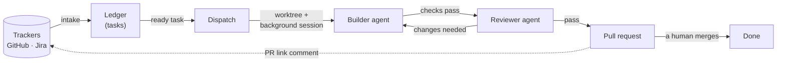
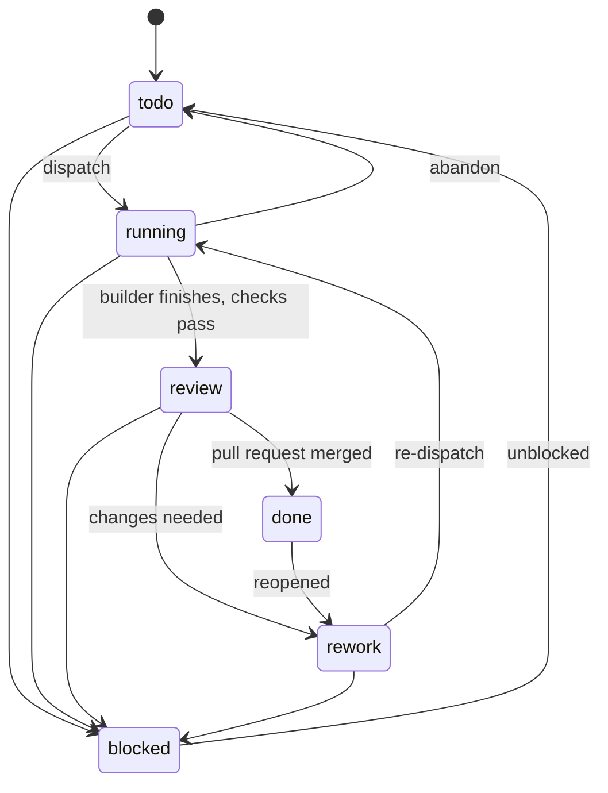

# Design

**Status:** draft for review, 2026-10-01. It introduces decisions D-008 to D-017
(see [DECISIONS.md](DECISIONS.md)). Behaviour that comes from Claude Code itself
was checked against version 2.1.287 and its docs on that date.

## 1. What it does

Agent Command Center turns tickets into reviewed pull requests, with a human
deciding what merges. Tickets come in from GitHub Issues or Jira and become
tasks. Each ready task gets its own git worktree and a background Claude Code
session. The agent builds the change and runs the project's checks. A second,
fresh agent reviews the diff, a pull request opens, and the link is posted back
to the ticket. A VSCode panel shows all of it and holds the buttons.



## 2. The pieces

| Piece | What it is | Uses |
|---|---|---|
| `core` | TypeScript library: ledger, config, state rules, paths, receipts | filesystem only |
| `acc` CLI | Every action, and the **only writer** of state | core, `git`, `gh`, `claude`, `sf` |
| Plugin `acc` | Skills, hooks, a reviewer agent, and `bin/acc` for agents | Claude Code |
| VSCode extension | Views and buttons. Reads state directly, changes it only through `acc` | core, `acc`, `claude agents --json`, `gh` |

Claude Code supplies the agent runtime, and none of it is rebuilt here:

- background sessions (`claude --bg`), with `claude attach`, `logs` and `stop`
- live status (`claude agents --json`)
- hooks

## 3. Where state lives

| Path | In git? | Holds |
|---|---|---|
| `.acc/config.json` | yes | Project settings ([section 4](#4-config)) |
| `.acc/rules.md` | yes, optional | Project rules the reviewer checks |
| `.acc/packet.md` | yes, optional | Override for the builder's instructions template |
| `<git-common-dir>/acc/ledger.json` | no | Tasks: the current snapshot |
| `<git-common-dir>/acc/events.jsonl` | no | Append-only log of every change |
| `<git-common-dir>/acc/receipts/<sha>/<gate>.json` | no | Check results, tied to a commit |
| `<git-common-dir>/acc/reviews/<task>-<sha>.json` | no | Reviewer verdicts |
| `<git-common-dir>/acc/packets/<task>.md` | no | The rendered instructions each builder got |
| `<git-common-dir>/acc/logs/` | no | Full check output |
| `~/.acc/` | n/a | Machine-wide: list of managed repos, the heavy-check semaphore |

**Why the git common directory (D-008).** `git rev-parse --git-common-dir`
gives the same directory from the main checkout and from every worktree, so
every agent and the extension see one ledger. Files there never appear in a
diff, never conflict on merge, and are never pushed.

The tracker stays the shared record that teammates see. The ledger is this
machine's orchestration state. `acc sync` can rebuild it from the tracker, the
branches and the pull requests.

## 4. Config

`.acc/config.json` for a Salesforce project with an org per environment:

```json
{
  "schema": 1,
  "project": "Acme",
  "profile": "salesforce",
  "github": { "repo": "acme-co/acme-salesforce", "account": "work-account" },
  "commitIdentity": { "name": "Jane Doe", "email": "jane@example.com" },
  "environments": [
    { "name": "Dev", "org": "Acme Dev", "default": true, "promotesTo": "uat" },
    { "name": "UAT", "org": "Acme UAT", "promotesTo": "production" },
    { "name": "Production", "org": "Acme Production", "protected": true }
  ],
  "environmentSpecific": "manifest/environment-specific.txt",
  "knownDrift": "manifest/known-drift.txt",
  "trackers": [{ "kind": "jira", "site": "example.atlassian.net", "project": "ACME" }],
  "agents": { "max": 3, "permissionMode": "acceptEdits" },
  "autonomy": "manual",
  "worktrees": { "root": "../acme-salesforce.worktrees" },
  "gates": { "required": ["format", "static", "validate"] }
}
```

A project with no Salesforce in it, such as this repo, sets
`"profile": "generic"`, gives one environment (`main`, no org), and lists its
check commands under `gates`.

**A branch is named after its environment (D-015).** The branch is the
environment name in lower case: `dev`, `uat`, `production`. Nobody has to
remember a mapping, and the tool can check it.

In the `salesforce` profile, the environment name *is* the sandbox name, which
Salesforce puts in the org's URL (`acme--uat.sandbox.my.salesforce.com` →
`uat`). Production's org isn't a sandbox and its branch is `production`.
`acc doctor` checks every environment's org against its branch and refuses to
dispatch if one doesn't match.

| Field | Meaning |
|---|---|
| `github.account` | The `gh` account for this repo (D-007). `acc` passes `GH_TOKEN` on every call and sets the repo's commit identity and credential helper on `acc init` |
| `environments` | Where work lands. Each has a name, a branch (by default the lower-cased name) and, in the `salesforce` profile, an org alias. A task builds from one environment's branch, and its pull request goes back into it. **Protected** environments never receive agent work. `promotesTo` gives the promotion path ([section 11](#11-landing)) |
| `environmentSpecific` | A list of files that differ by design in every environment, such as email service addresses, SSO and org settings. These are never edited by a task, never deployed, and never promoted (D-016) |
| `knownDrift` | Files that a drift check should expect to differ, such as features a sandbox lacks or ordering noise. They can still be edited and promoted |
| `trackers` | Where intake reads from. Several are allowed |
| `agents.max` | Most builder sessions at once, default 3 |
| `autonomy` | How much the loop does on its own ([section 12](#12-the-orchestrator-loop)) |
| `worktrees.root` | Where task worktrees go. The default is a sibling folder outside the repo ([section 7](#7-dispatch)) |
| `gates` | Which checks are required, plus per-check overrides |

## 5. Tasks and the ledger

A task is one unit of work, usually one ticket.

| Field | Example | Notes |
|---|---|---|
| `id` | `ACME-34`, `GH-12`, `T-3` | Tracker key, or `T-n` for a manual task. Used in branch, worktree and session names |
| `title`, `brief` | | Copied from the ticket at intake. `brief` holds the body and acceptance criteria |
| `source` | `{ "kind": "jira", "key": "ACME-34", "url": "…" }` | |
| `environment` | `dev` | One of the config environments. Defaults to the `default` one |
| `deps` | `["ACME-30"]` | Tasks that must be `done` first |
| `state` | `running` | See below |
| `run` | `{ "bgId", "sessionId", "worktree", "branch", "startedAt" }` | Set on dispatch |
| `pr` | `{ "number", "url", "state" }` | Set on land |
| `history` | `[{ "at", "by", "from", "to", "reason" }]` | Every change, and who made it |

### States



Two states aren't stored. They're derived when the ledger is read:

- **Ready** means `todo` with every dependency `done`.
- **Needs you** means `running` while the session waits on a person.

| Shown as | Icon | Colour | Meaning |
|---|---|---|---|
| To do | `circle-outline` | neutral | Waiting on dependencies, or not picked up yet |
| Ready | `play-circle` | blue | Can be dispatched |
| Running | `sync` (spinning) | blue | A builder is working |
| Needs you | `bell` | **orange** | The session is waiting for permission or an answer |
| In review | `eye` | blue | Checks passed. Waiting for the reviewer or the pull request |
| Rework | `debug-restart` | **orange** | The reviewer or a human asked for changes |
| Blocked | `circle-slash` | **orange** | Stopped. A reason is required |
| Done | `check` | neutral | Merged |

Orange means a person should look, and blue means work is moving. Every state
has an icon and a label, so colour never carries the meaning alone.

### Transition rules

| Change | Who may make it | Requires |
|---|---|---|
| todo → running | human, orchestrator | Every dependency done, below `agents.max`, environment not protected |
| running → review | builder (`acc done`), human | A passing receipt for every required check, on the current `HEAD` |
| review → rework | reviewer, human | Findings or a reason |
| rework → running | human, orchestrator | |
| review → done | `acc sync` (pull request merged), human | |
| any → blocked | anyone | A reason |
| blocked → todo | human | |
| running → todo | human | A reason. The worktree is kept |

Anything else needs `--force --reason` and is recorded as an override.

**Writes.** Only `core` writes. It takes a lock (an atomic `mkdir` of
`ledger.lock`, broken if its owner process is gone). It then appends the event,
writes the new snapshot to a temporary file, and renames it into place. Readers
never see a half-written file.

## 6. Intake

Every source produces the same task input shape, and `acc import` reads it as
JSON. Adding monday.com later means adding one more producer.

| Source | How | Dependencies from |
|---|---|---|
| GitHub Issues | `acc intake github [--label L]`, run directly through `gh` with the repo's account | `Depends on #N` and `Blocked by #N` lines in the issue body |
| Jira | The `acc:intake` skill: Claude queries the Atlassian connector with JQL and pipes the results to `acc import` | "is blocked by" issue links |
| Manual | `acc add "title" --brief …` | `--dep` |

Intake is idempotent, keyed by tracker key, and it never changes the tracker.

## 7. Dispatch

`acc dispatch <id>` does the following:

1. **Checks.** The task is ready, running sessions are below `agents.max`, and
   the environment isn't protected, and its branch matches its org (D-015).
2. **Creates the worktree.** It fetches, then runs
   `git worktree add <root>/<id> -b task/<id>-<slug> origin/<branch>`, where `<branch>` is the environment's branch. On a
   rework, it reuses the existing worktree.
3. **Sets up the worktree.** In the `generic` profile, that means running
   `worktrees.setup` commands, such as `npm ci`. In the `salesforce` profile, it
   means writing `.sf/config.json` with the environment's org and linking
   `node_modules` from the main checkout.
4. **Writes the instructions.** It renders the packet ([section 8](#8-the-packet)).
5. **Launches the agent.** With the worktree as the working directory, it runs
   `claude --bg --name <id> --permission-mode <mode> --settings <json> "<packet>"`.
   The settings JSON sets `ACC_TASK` and `ACC_ROLE=builder` in the session's
   environment, plus an allowlist of routine commands.
6. **Records the run.** It stores the background id and session id, and moves
   the task to `running`.

`acc dispatch --foreground` runs the same session in the current terminal
instead. You can drop into any background session with `claude attach <id>`.

**Why background sessions (D-009).** Claude Code's supervisor keeps them running
after the terminal closes. They report `working`, `blocked`, `done`, `failed` or
`stopped`, and what they're waiting for, through `claude agents --json`. Attach,
logs and stop come for free. The feature is a research preview, so
`--foreground` is the fallback.

**Why the tool makes its own worktrees.** There are three reasons:

- `claude --worktree` can only branch from the default branch or `HEAD`. A task
  has to start from its environment's branch.
- A sibling folder keeps duplicate source trees out of VSCode search and out of
  the Salesforce extensions' indexing.
- Claude Code's cleanup sweep leaves worktrees it didn't create alone. Cleanup is
  then `acc`'s job, and it refuses to delete unmerged or uncommitted work.

## 8. The packet

The packet is what a builder is told. It's rendered from `templates/packet.md`,
or from the project's `.acc/packet.md` if there is one. It contains:

- **The task:** id, title, link, brief and acceptance criteria.
- **Where:** the worktree path, the environment's branch and, for Salesforce,
  its org.
- **The finish line:**
  - Run each required check with `acc gate run <name>`.
  - Commit as `<id>: <summary>`. For GitHub, add `refs #N`. Never write `fixes`
    or `closes`.
  - End with `acc done`, or with `acc block "<reason>"` if stuck.
- **Never:**
  - push, merge or deploy
  - edit files outside the worktree
  - edit an environment-specific file
  - change the ticket
- **Rules:** the profile's rules and the project's `.acc/rules.md`.

When the session resumes or compacts, the SessionStart hook injects a short
version again.

## 9. Gates and receipts

A gate is a named check. It has a command, a scope (usually the files changed
since the environment's branch), whether it's required, and whether it's heavy.

**Generic profile.** `format`, `lint`, `test` and `build` run the commands in
config.

**Salesforce profile:**

| Gate | Runs | Required |
|---|---|---|
| `format` | `prettier --check` on changed files | yes |
| `lint` | ESLint on changed LWC and Aura JavaScript | when any changed |
| `static` | `sf code-analyzer run` on changed files. Fails at severity 2 or worse, which is configurable | yes |
| `lwc-tests` | `sfdx-lwc-jest --findRelatedTests` | when an LWC changed |
| `validate` | `sf project deploy validate` of the changed source against the environment's org. Uses `NoTestRun` when no Apex changed. Otherwise `RunSpecifiedTests`, with the tests the builder names and its reason for each | yes |

- **Changed files** come from `git diff --name-only <branch>...HEAD`, minus
  environment-specific files.
- **Deletions** are out of scope for agents in v1. A task that needs destructive
  changes goes to a person.
- **Receipts** record the gate, commit, pass or fail, timings, a summary, the log
  path, and any Salesforce job id, org id and tests run. They're tied to a
  commit, so a new commit makes them stale.
- **Heavy gates** take a slot in a machine-wide semaphore (one at a time by
  default) and run under `nice -n 15`.

**Agents validate; they never deploy (D-011).** Parallel branches deploying to
one shared sandbox would overwrite each other's work. A deploy happens after
merge, from the environment's branch, one at a time, through
`acc deploy <environment>`. It sends only the changed components and never an
environment-specific file. For a protected environment, it also needs a person's
`--confirm-production`.

**Drift.** `acc drift <environment>` retrieves the baseline manifest into a
throwaway worktree. It reports what changed in the org since its branch was last
updated, ignoring `knownDrift` and `environmentSpecific`. The org isn't changed.

## 10. Review

`acc review <id>` gives a fresh agent four things:

- the packet
- the diff against the environment's branch
- the receipts
- the project's rules

It runs as `claude -p --agent acc:reviewer --permission-mode plan
--output-format json --json-schema <verdict>` inside the worktree. The reviewer
starts with no context and can't edit anything.

- **It checks:** whether the acceptance criteria are met, whether the project
  rules are followed, whether the change strayed outside the ticket, and whether
  the tests actually exercise the change.
- **It skips formatting,** which the checks already cover.
- **Its verdict:** `{ "verdict": "pass" | "changes", "findings": [{ "rule",
  "file", "line", "message" }] }`.
- **On `changes`:** the task moves to `rework`, and the findings are added to
  the packet for the next run.

## 11. Landing

`acc land <id>` first requires two things on the current `HEAD`: a passing
review, and passing receipts for every required check. Then it:

1. Pushes `task/<id>-…` with the repo's account.
2. Opens the pull request:
   `gh pr create --base <branch> --title "<id>: <title>"`. The generated body
   holds a summary, an acceptance checklist, the check table, the review verdict
   and the ticket link.
3. Comments the pull request link on the ticket. For GitHub, it does this
   itself. For Jira, it records the comment as pending, and the `acc:land` skill
   posts it through the connector.

It never merges.

**After the pull request opens:**

- `acc sync` polls open pull requests. A merged one makes its task `done`. A
  closed-unmerged one moves its task to `blocked` with the reason. Failing CI
  shows the task as **needs you**.
- `acc cleanup <id>` removes the worktree and local branch, but only once the
  pull request is merged and the worktree is clean.

### Promotion

Promotion moves merged work one step along the `promotesTo` path. A person
starts it with `acc promote <environment>`. That opens a pull request from the
environment's branch into the next one, and validates the change against the
next environment's org. Environment-specific files are left out. If the pull
request would delete files in the next environment, `acc` warns before opening
it, because that usually means the two branches have drifted apart.

## 12. The orchestrator loop

The loop is ordinary code, not an agent (D-010). `acc tick` works out the next
actions from the ledger, the sessions and the pull requests. `acc run` repeats
tick-and-act on a timer, and the extension can host it.

| `autonomy` | What runs on its own |
|---|---|
| `manual` (default) | Nothing. The extension shows the suggested actions as buttons |
| `dispatch` | Dispatching ready tasks, up to `agents.max` |
| `review` | Also starting the reviewer when a builder finishes |
| `full` | Also opening pull requests for reviewed work |

Nothing merges automatically, and nothing deploys to a protected environment. An
agent is used for judgment, not routing. The `acc:orchestrate` skill helps break
a large ticket into tasks, triage a blocked task, or write rework guidance.

## 13. Plugin

```
plugin/
  .claude-plugin/plugin.json   name "acc"
  bin/acc                      bundled CLI; on agents' PATH while the plugin is enabled
  hooks/hooks.json
  agents/reviewer.md
  skills/intake/  task/  orchestrate/  land/
  profiles/generic.json  salesforce.json
  templates/packet.md  pr-body.md
```

A `.claude-plugin/marketplace.json` at the repo root lists `./plugin`. During
development, `claude plugin marketplace add <this repo>` loads it in place.

Hooks return immediately unless the working directory is inside a repo with
`.acc/config.json`:

| Event | Matcher | Does |
|---|---|---|
| SessionStart | | In a task worktree, links `session_id` to the task. On resume or compact, re-injects the short packet |
| PreToolUse | `Edit\|Write\|NotebookEdit` | Stops a builder editing outside its worktree, or editing an environment-specific file |
| PreToolUse | `Bash` | Stops a builder from: pushing to any branch except its own, `gh pr merge`, a real `sf project deploy start`, `fixes` or `closes` keywords in a commit message, `--no-verify`, and `acc set` beyond `done` and `block` |
| Stop | | If a builder's task is still running and not finished, reminds it of the finish line once |

The builder is identified by `ACC_TASK` and `ACC_ROLE` in its environment.
Whether `--settings` env values reach hook processes is checked in M2. The
fallback is matching the hook's `cwd` to a task worktree.

## 14. VSCode extension

An **Agents** container in the activity bar holds three views:

- **Board** (webview). Columns are To do, Ready, Running, In review, Rework,
  Blocked and Done. Each card shows id, title, agent state, checks, pull request
  and buttons.
- **Sessions** (tree). Every Claude Code session from `claude agents --json`,
  with task-linked ones first. Each shows its state and what it's waiting for.
- **Worktrees** (tree). For each task: branch, uncommitted files, ahead or behind
  the environment's branch, pull request and CI.

**Status bar:** running, needs you, and in review counts, each with its icon.

**Notifications:** a session needs you (with an **Attach** button), a task is
ready for review, or CI fails on a task's pull request.

**Commands:** Dispatch, Attach (`claude attach` in a terminal), Review, Land,
Clean up, Intake, Open packet, Open pull request, Block or unblock, and Refresh.

| Data | Source | Refresh |
|---|---|---|
| Tasks | `ledger.json` | When the file changes |
| Sessions | `claude agents --json` | Every 5 s while visible, 30 s hidden |
| Worktrees | `git worktree list`, `git status` | When the ledger changes, and every 15 s |
| Pull requests, CI | `gh pr list --json …` with the repo's account | Every 60 s |

The extension handles every workspace folder that has `.acc/config.json`.

### Walkthrough

The extension's first feature is a guided setup, built on VSCode's walkthroughs
(the **Get Started** pages). It opens on its own the first time a folder has no
`.acc/config.json`. There are two walkthroughs:

1. **Set up this machine:** steps A1 to A4 in [ONBOARDING.md](ONBOARDING.md).
2. **Onboard a project:** steps B1 to B11. The Salesforce-only steps are hidden
   for a `generic` project.

Each step explains why it matters and has up to three buttons:

- **Do it:** runs the `acc` command in a visible terminal, so you see exactly
  what runs.
- **Open in Salesforce:** opens the right Setup page with `sf org open --path`.
  Some steps are clicks only a person can make, such as switching on source
  tracking.
- **Check:** runs the step's check.

When a check passes, the extension sets that step's context key, and the step
ticks itself (`completionEvents: ["onContext:acc.step.<id>"]`). The extension
re-runs every check when a folder opens, so the walkthrough always reflects the
real state, not what was clicked.

**One list of steps drives everything (D-017).** Steps are data in `core`. Each
one has:

- an `id`, such as `B8.tracking`
- a title and a "why"
- the profiles it applies to
- a `check()` that returns pass, fail or unknown, with detail
- a fix: an `acc` command, a Setup path, or a docs link

`acc doctor` runs the same checks and prints the same text. `acc onboard` walks
through them in a terminal. Later, ONBOARDING.md is generated from the same
list. The walkthrough, the CLI and the docs can't drift apart.

## 15. Safety

- Agents work only in their own worktree, on their own branch.
- Agents can't push to an environment branch, merge, deploy, or touch the tracker.
- Protected environments change only through a person's promotion pull request.
- Environment-specific files are never edited by a task, deployed or promoted.
- Every state change records who made it and why.
- Credentials never enter a repo: `GH_TOKEN` is passed per call, and the org
  logins stay in the `sf` keychain.
- Hooks do nothing in repos that haven't opted in.
- A cap on agents, plus a one-at-a-time semaphore for heavy checks.

## 16. Prerequisites

`acc doctor` checks each of these and says how to fix what's missing:

- Node 20 or later, and git 2.40 or later
- Claude Code with `--bg` support
- `gh`, logged in as the configured account
- for Salesforce: `sf` and Code Analyzer, plus each environment's org logged in
  with its sandbox name matching its branch
- the config is valid, and the ledger directory can be written

## 17. Testing

- **core:** a `node:test` unit test for every transition rule and for the lock.
- **CLI:** integration tests against throwaway git repos with real worktrees.
  Fake `claude`, `gh` and `sf` scripts on `PATH` record their calls and return
  fixtures.
- **Plugin:** `claude plugin validate --strict`, and each hook run against
  fixture payloads.
- **Extension:** the logic lives in core and is tested there. The UI is checked
  by hand at first.

## 18. Build order

Each milestone becomes GitHub Issues on this repo. The tool's own backlog is the
first thing it pulls in.

| Milestone | Delivers | Done when |
|---|---|---|
| M1 Core, CLI and onboarding checks | Ledger, config, state rules, lock, events. The onboarding step list. `init`, `add`, `import`, `list`, `ready`, `set`, `doctor`, `onboard` | Unit tests cover every rule. `acc doctor` passes on a fully set-up pilot repo and fails, with the right fix, on a fresh one |
| M2 Walkthrough | Extension skeleton plus the two walkthroughs, driven by the onboarding checks | A new project is onboarded from the walkthrough alone, and every step ticks itself |
| M3 Dispatch | Worktrees, setup, packet, background launch, session linking, `done`, `block`, `cleanup` | A real task runs end to end in this repo |
| M4 Gates | Gate runner, receipts, semaphore, the Salesforce gates, `drift` | `validate` passes against a sandbox from a worktree |
| M5 Review and land | Reviewer agent, verdicts, pull request, comments, `sync`, `deploy`, `promote` | A task goes from ticket to an open pull request |
| M6 Plugin | Manifest, `bin/acc`, hooks, skills, marketplace | `claude plugin validate --strict` passes, and the hook tests pass |
| M7 Extension views | Board, Sessions, Worktrees, status bar, notifications | Three tasks run at once, all watched from VSCode |
| M8 Pilots | This repo (generic), then a Salesforce client repo | One sprint of real tickets lands through it |

From M3 on, the remaining milestones are built by dispatching agents with what
already exists.

## 19. Left out of v1

- destructive Salesforce changes
- a merge queue
- automatic rework when CI fails
- monday.com and Slack
- cloud sessions
- sharing a ledger across machines
- a Developer sandbox for each agent

## 20. Open questions

1. **Default autonomy.** This draft says `manual` until the loop has earned
   trust. Is that right?
2. **Skipping an environment.** Must promotion always pass through every step
   in `promotesTo`? Or may a person skip one, for example a QA sandbox that's
   out of date?

Answered: the Salesforce pilot's tracker is Jira. Its tickets move there from
Azure DevOps first, so Azure DevOps intake isn't needed.
